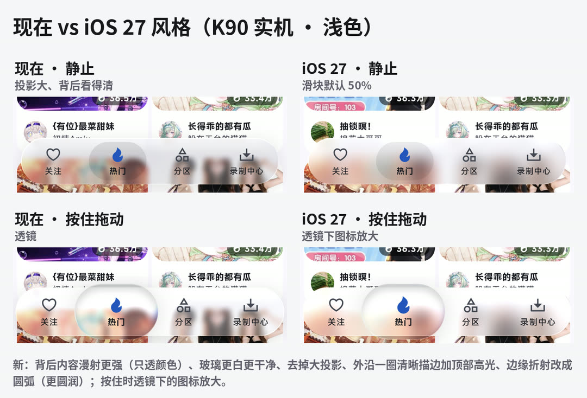
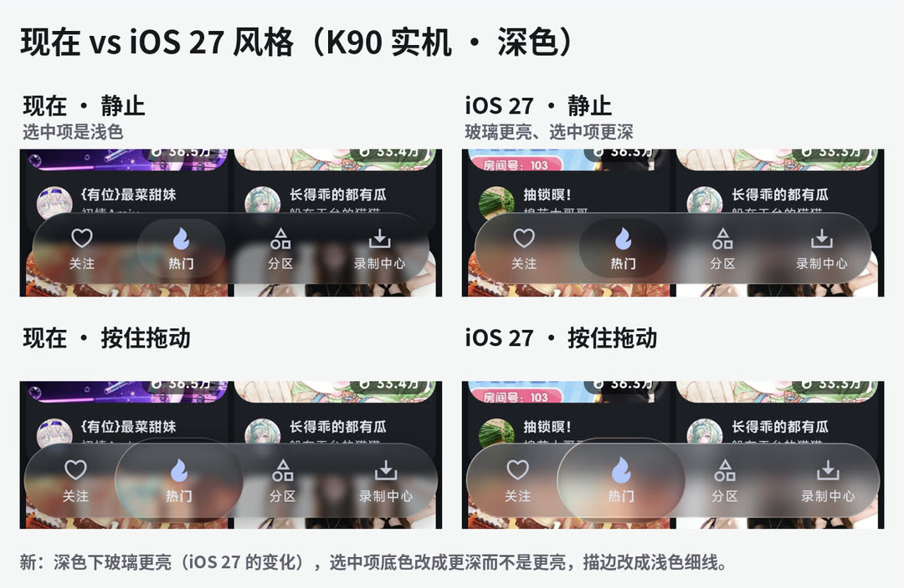
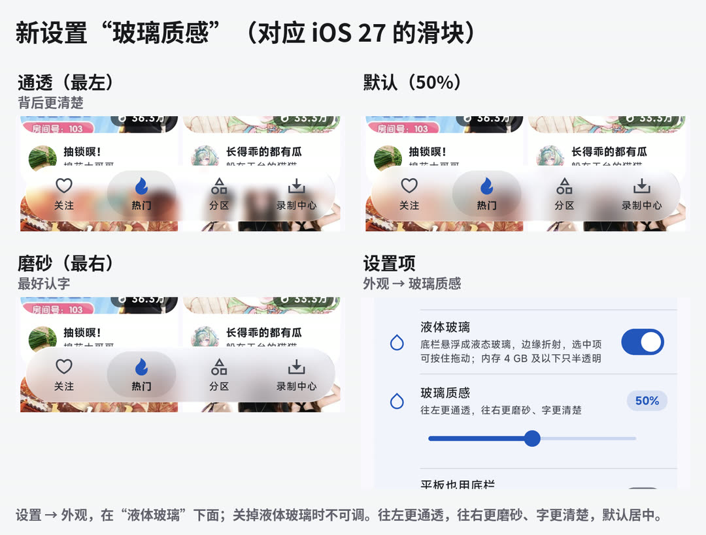

# A01.8 液体玻璃按 iOS 27 重做质感，加“玻璃质感”滑块

- 编号、状态、档位、规模：以登记表为准，见[子分类页](../README.md)和 [STATUS.md](../../../STATUS.md)
- 来源：用户 2026-10-22：“干脆参考苹果 iOS 26 是怎么实现的，进一步重构优化玻璃底栏的质感、动画？”，随后补充“是 iOS 27 最新”；同时决定 5.4.7 等这次重做完再发（Y01.18）
- 相关：A01.5（液体玻璃）、A01.6（着色器折射）、A01.7（手感，照酷安）；V02.13（issue #11，拖动时水滴每帧都跟手）；A01.9（往下滚动时底栏收起，单独确认）

## iOS 27 的液态玻璃（2026-10-22 调研）

iOS 26 引入液态玻璃，iOS 27 在它的基础上改了一轮。和底栏有关的：

- **漫射更强**：苹果说 iOS 27 的玻璃“把背后复杂的内容漫射得更有效，层次和分隔更清楚”，折射更均匀、对比更好。
- **清晰的边**：玻璃元素外沿有一圈更明确的边（浅色下是暗边），高光更亮；不再靠投影把玻璃和内容分开，投影基本去掉了。
- **高光是静态的**：iOS 26 的高光随陀螺仪移动，iOS 27 不再动。
- **深色模式**：深色下的玻璃更亮；底栏选中项的底色变得更深，而不是更亮。
- **透明度滑块**：设置 → 外观 → 液态玻璃，从“更通透”到“更有色调（磨砂）”连续可调，默认在中间，全系统生效。
- 底栏本身仍是浮在内容上的胶囊；按住选中项时变成会放大的玻璃透镜，可以拖到别的页；部分应用（音乐等）往下滚动时底栏收起成小胶囊。

来源：[Meet Liquid Glass（WWDC25）笔记](https://wwdcnotes.com/documentation/wwdc25-219-meet-liquid-glass/)、[MacRumors：iOS 27 调整液态玻璃透明度](https://www.macrumors.com/how-to/ios-27-tone-down-liquid-glass-transparency/)、[Liquid Glass: First Impressions of iOS 27](https://www.ryanthomson.net/articles/liquid-glass-ios-27-first-impressions)、[What Designers Need to Know About iOS 27](https://designfornative.com/what-designers-need-to-know-about-ios-27/)、[BGR：iOS 27 的液态玻璃修正](https://www.bgr.com/2191219/ios-27-liquid-glass-fix-customization/)、[Donny Wals：iOS 26 的底栏](https://www.donnywals.com/exploring-tab-bars-on-ios-26-with-liquid-glass/)。都是二手资料，苹果没有公开实现，参数是照效果调的。

## 我们的做法

| 项 | 之前（A01.6、A01.7） | 现在 |
|---|---|---|
| 背后内容的漫射 | 着色器前模糊 4 | 6～16，随“玻璃质感”滑块（默认 11） |
| 色调 | 深色 32%、浅色 28%，固定 | 深色 18%、浅色 14%，再加 48% × 滑块（默认约 42%、38%） |
| 边缘折射 | 平方衰减，边宽 20、折射 12 | 圆弧曲线（厚玻璃的圆边，更“圆润”），边宽 26、折射 16 |
| 边 | 左上一道亮边 | 外沿一圈 1.2 的细线：浅色下压暗 16%，深色下提亮 7%；左上亮边更亮（浅色 1.2、深色 0.8） |
| 投影 | 胶囊下 24 模糊的投影 | 去掉 |
| 深色玻璃 | surfaceContainer | surfaceContainerHighest（更亮） |
| 静止的选中项 | 浅色 10% 黑、深色 10% 白 | 浅色 8% 黑、深色 24% 黑（都比玻璃深） |
| 按住时的透镜 | 背后放大，图标不变 | 透镜里的图标随按下放大到 1.14 倍，和背后一起放大 |
| 没有着色器时 | 半透明色 66%、74%，白边 | 58%、64% 再加 24% × 滑块；边线浅色 10% 黑、深色 16% 白 |
| 拖动跟手 | 每个移动事件重开弹簧，常常整帧不动 | V02.13：只挪正在跑的弹簧的终点 |

新设置 **玻璃质感**（`liquidGlassFrost`，0～1，默认 0.5）：设置 → 外观，在“液体玻璃”下面，关掉液体玻璃时不可调；往左更通透，往右更磨砂、字更清楚。

## 原型和确认（K90 实机）

本地原型分支 `proto-glass27`（编译开关切新旧样子，不推送）。用户 2026-10-22 看过下面三张图和一段拖动录屏，选了：照原型做 iOS 27 质感、加“玻璃质感”滑块、“往下滚动时收起”先做原型再定（A01.9）。

浅色（左现在、右新；上静止、下按住拖动）：

深色：

滑块三档和设置项：

## 验证

- 测试：`liquid_glass_bar_test` A01.8（没有投影、滑块的值到玻璃、按住时透镜里的图标放大到 1.14 倍再回到 1）；`home_test` A01.5 用例里改滑块后玻璃跟着变；紧凑底栏用例改成看玻璃的高度（原来看投影那层的圆角）。
- K90：原型截图和录屏见上；正式版的效果和掉帧在发 5.4.7 前一起看。
