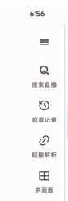
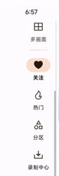
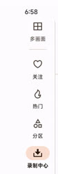
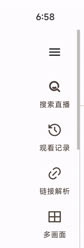

# A06.6 验证

日期：2026-10-24（北京时间）。候选提交 `8a152c8f567433e8a3e6c2a3fba4bffb7afa992d`。

## 已验证

同提交 profile 测试包保留原有关注、录制条目和设置。小横屏实际向上拖动整条侧栏，四个目的地可见；点击录制中心进入正确页面，反向拖动可重新访问顶部菜单与工具。开始时一次较短拖动未观察到位移，随后使用稳定的 1 秒拖动确认移动，不将首次未生效操作计作通过。原始截图仅在本地保留，仓库图片只裁切侧栏，省略原有关注与录制内容。

## 复核步骤

检查手机自动和原始旋转状态；横屏后在侧栏下部拖动；点击录制中心；反向拖到菜单。回到自动界面并恢复 free / user_rotation=0，恢复前台仍为测试包。

## 截图

