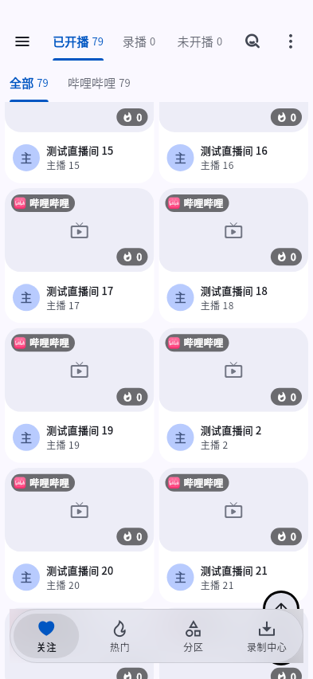
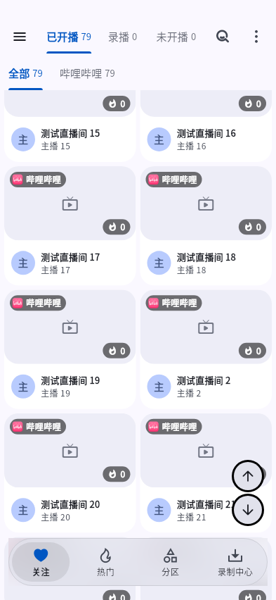
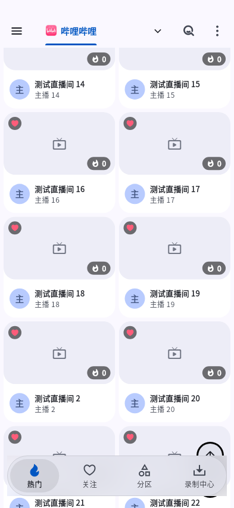
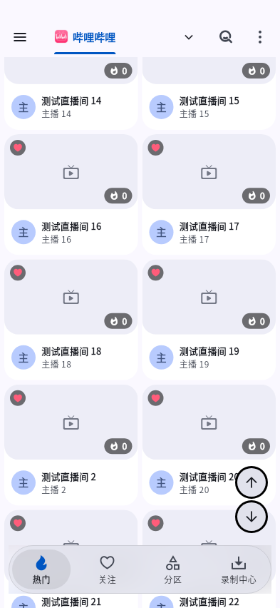

# 验证

使用真实主页组件和固定房间数据检查布局与点击；可选qa_capture输出合成帧。没有操作物理手机或正式Windows安装，不将合成渲染当作真机验证。

真机复验步骤：打开关注或热门列表，滚动超过一屏；上下箭头的完整点击区在玻璃上方。分别点击回顶/到底，确认没有误切底栏。切紧凑模式、隐藏/恢复导航及横竖屏后位置正确。

## 合成布局对照

使用生产PureLiveApp与固定本地房间数据，不访问真实平台。105项相关回归通过；Android 393×852截图如下，完整点击框已移到玻璃上方。

| 页面 | 修改前 | 修改后 |
|---|---|---|
| 关注 |  |  |
| 热门 |  |  |

包内版本仍为5.4.20，本修复尚未发布新的安装包；待下一次发版交付。
