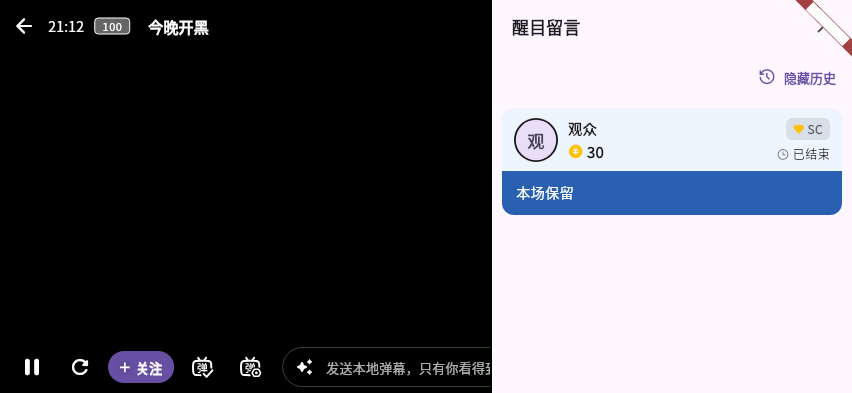

# A07.26 验证

## 自动验证

live_play_room_test.dart、tv_test.dart：新增 3 条，对应改前失败、改后通过。常亮测试包含请求丢失、第一次异常后重试、延迟开启后的最终关闭；iPad 手势为模拟通道；SC 检查真实命中与动画关闭，不仅检查组件存在。

## 真机待验

手机竖屏全屏、横屏、平板、桌面、电视分别检查：无活动 SC 无按钮；收到后显示，打开后仍连续播放；最后一条过期隐藏入口；历史开关只读本会话。关闭设置隐藏入口。Back 先关面板，再退出全屏。电视上下/翻页键滚动，不切房；返回后可再次打开控制栏。

本轮没有执行物理设备操作。逐条记录设备、系统、提交、安装包哈希、输入方式和结果；待真机不等于已修复验收。任何发版要另走发布流程，不改本轮版本号与更新 JSON。

## 合成界面证据

以下为 Widget 测试，假播放、假房间、无真实平台数据；不是原生设备截图。改前画面只将对应生产入口文件还原到 da1e678d，使用相同夹具；截图后已校验恢复工作树指纹。用于核对入口、焦点、布局和列表，不能证明物理播放或遥控器兼容性。

2026-10-23 补充自查：扩展同一电视回归用例，原候选版无法用方向键聚焦历史开关（tv-history-before.log 失败）。改用已有 TvButton 作为同一 SuperChatList 的开关，仅定制输入组件；列表顶部按上或左右键到历史开关，OK 切换，按下回到滚动，Back 仍先关面板；tv-history-after.log 通过。未扩大历史保留范围。首轮完整门禁主动停止以纳入此修正，最终同提交门禁另跑，不能引用首轮为通过。

同一电视回归还在运行中从 1080p 切到 4K 与 720p，检查标题不会垂直截字，遥控切换历史及返回仍正确。以下仍是合成 Widget 图，不是真机。

