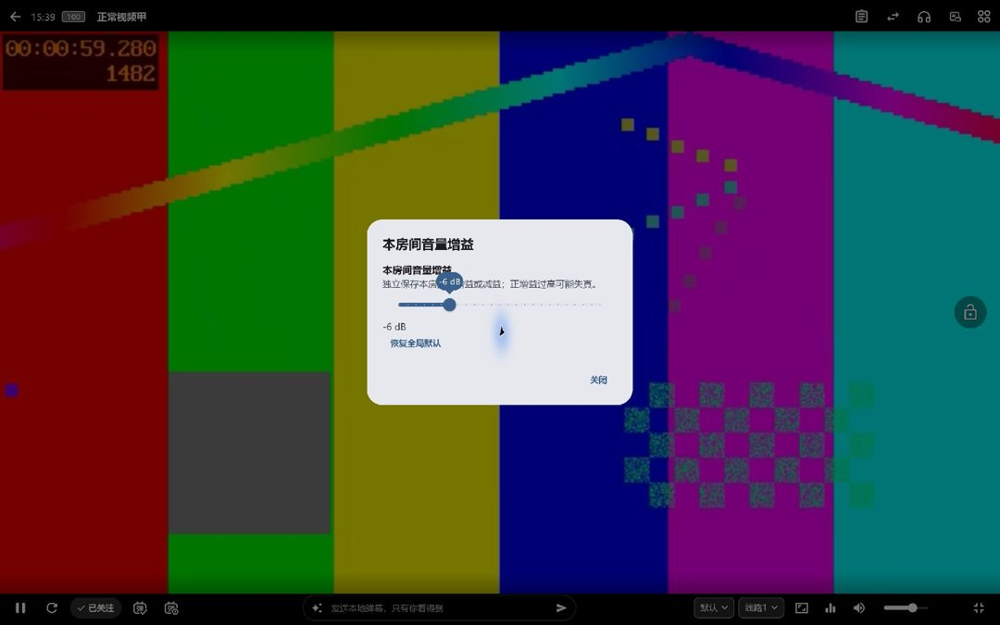

# 发布验证

5.4.27+5131，安装包源码`483c01481b3297fd9a43f202247064ee87f69a1e`，代码PR [#127](https://github.com/wzgrx/PureLive/pull/127)，代码合并`51638db8942f1ba1d33e2d796f1c0bc7ca5257cd`。完整all/14门禁通过且源码无漂移。新增六类反证在原实现失败，168项Kuaishou/Douyin回归通过；相关直播、多画面、电视、迷你窗、后台与增益回归及最终全量测试分别留有日志。旧表情测试改为明确读取文件资源并在建树前等待加载，避免依赖未确定的资源等待时长；错误夹具与中断日志保留且不作为通过证据。

最终十包与SHA256SUMS逐项核对构建、本地和GitHub摘要，并重新匿名下载验证；发布页[5.4.27](https://github.com/wzgrx/PureLive/releases/tag/v5.4.27)。Windows独立目录验证M和工具条共享恢复音量、直接增益及多画面F/F11/I与Esc（字母键在英文输入状态验证，中文输入法组字状态未计为通过）；Android9专用AVD验证单清晰度初始焦点、Right/Left和当前项确认。Linux最终TAR、iOS模拟器、两台托管Mac四次最终ZIP启动及独立原生录制/播放探针分别记录。

原始证据位于仓库外outputs/purelive-5427-20261031。原Claude47文件逐文件哈希与HEAD保持。没有使用物理手机，不将专用AVD或托管机计为原设备验收；原用户Cookie未取得，拒绝恢复由脱敏响应回归，公开直播另验播放地址与媒体字节，不能据此断言原Cookie已经失效。

回查原81条已关闭反馈：108、112重新打开修复，18的字母别名在5.4.9已有修复，本轮复核并补充回复；101、105、115、68、7的确认/致谢已回应。33、47、49按用户决定暂缓，以not_planned保持关闭且不称已修复；96维持明确拒绝。新126、128仅完成独立技术评估，登记V01.21、V01.22并公开回复，尚未交付而保留开放。

Windows最终ZIP SHA-256 `81e1e6c8c24a6bfb2fe33b6e06472b026185ecce838a8b3457e94a4d54afd20a`。实际进入底栏增益弹窗并调整、重置；普通音量独立。

