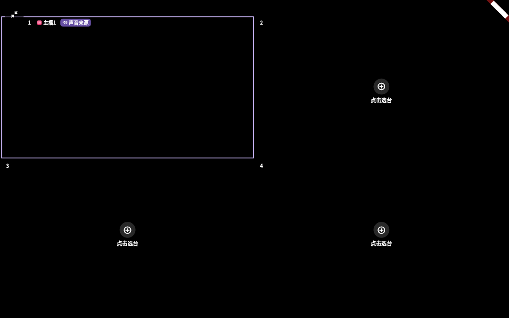
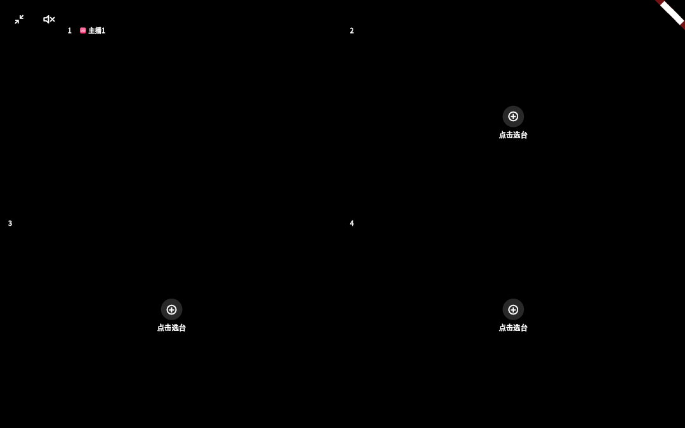

# A13.3 验证

## 自动验证

multiview_page_test.dart：新增 2 条，对应改前失败、改后通过。常亮测试包含请求丢失、第一次异常后重试、延迟开启后的最终关闭；iPad 手势为模拟通道；SC 检查真实命中与动画关闭，不仅检查组件存在。

## 真机待验

Windows、Linux、macOS 各用独立实例：打开至少两路，记录焦点格和各格音量；分别进入沉浸、全屏，点击静音及按 M 后恢复；输入框和组合键不触发静音，按住 M 不连跳。确认角标和静音按钮不重叠。

本轮没有执行物理设备操作。逐条记录设备、系统、提交、安装包哈希、输入方式和结果；待真机不等于已修复验收。任何发版要另走发布流程，不改本轮版本号与更新 JSON。

## 合成界面证据

以下为 Widget 测试，假播放、假房间、无真实平台数据；不是原生设备截图。改前画面只将对应生产入口文件还原到 da1e678d，使用相同夹具；截图后已校验恢复工作树指纹。用于核对入口、焦点、布局和列表，不能证明物理播放或遥控器兼容性。

