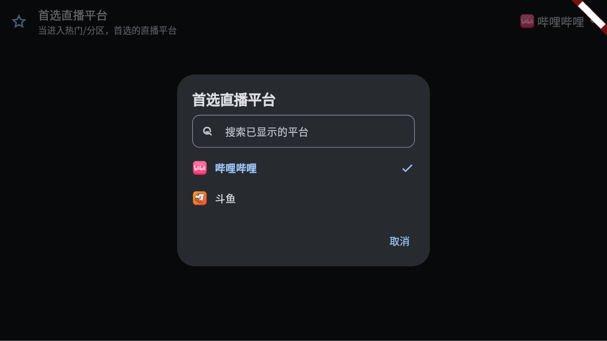
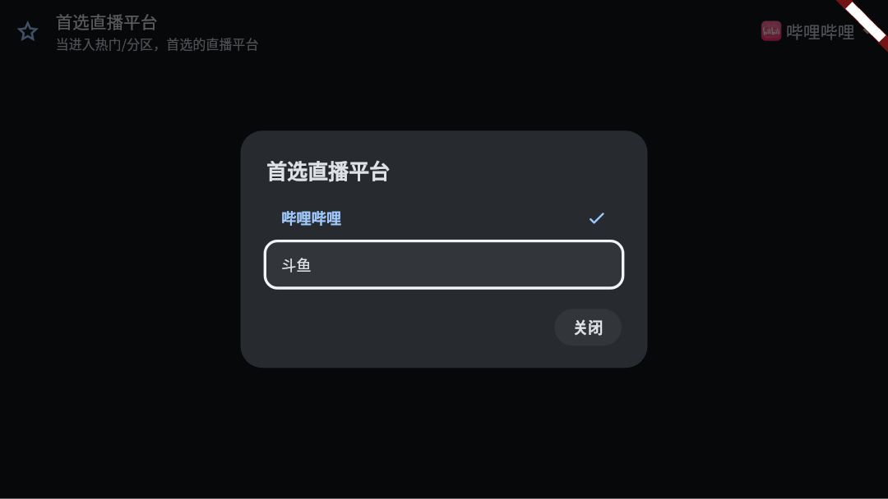

# A17.10 验证

## 自动验证

tv_preferred_platform_test.dart：新增 1 条，对应改前失败、改后通过。常亮测试包含请求丢失、第一次异常后重试、延迟开启后的最终关闭；iPad 手势为模拟通道；SC 检查真实命中与动画关闭，不仅检查组件存在。

## 真机待验

Sony KD-65X8566E / Android 9 / v7a：设置→平台显示与认证→首选直播平台，确认不弹键盘；方向键逐项走，OK 保存；重开检查当前项焦点，再选其他项后按 Back，设置值不变。手机入口保留筛选。

本轮没有执行物理设备操作。逐条记录设备、系统、提交、安装包哈希、输入方式和结果；待真机不等于已修复验收。任何发版要另走发布流程，不改本轮版本号与更新 JSON。

## 合成界面证据

以下为 Widget 测试，假播放、假房间、无真实平台数据；不是原生设备截图。改前画面只将对应生产入口文件还原到 da1e678d，使用相同夹具；截图后已校验恢复工作树指纹。用于核对入口、焦点、布局和列表，不能证明物理播放或遥控器兼容性。

## 5.4.9 发布

PR #27 合并 37a5f703901022cd7fcb88c0907cd3c84cd4ea68，实际构建与标签提交 a0fad683c0562e5856f0eddeec7f2df2efd030b9，随 [5.4.9](https://github.com/wzgrx/PureLive/releases/tag/v5.4.9) 发布。完整门禁、十包哈希及各端启动核验通过，详见 Y01.20；反馈者 iPad、Sony 电视、真实付费 SC 和各端完整交互未全部覆盖，保留待真机，不据此宣称所有硬件验收。
