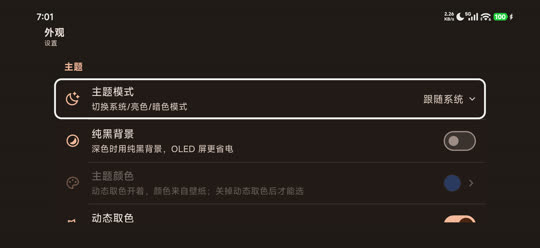
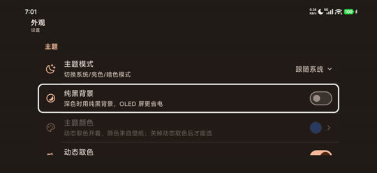
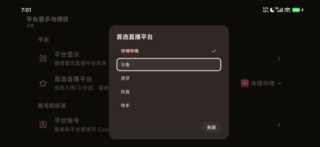
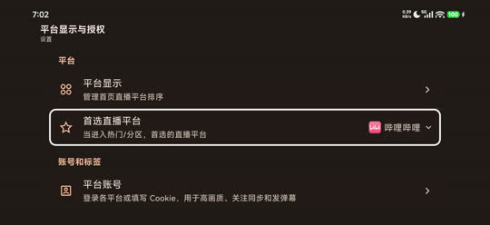

# A17.11 验证

日期：2026-10-24（北京时间）。候选提交 `8a152c8f567433e8a3e6c2a3fba4bffb7afa992d`。

## 已验证

二级外观页的焦点在主题模式和纯黑背景之间移动，大小保持行内，状态底色圆角正确；首选平台弹窗聚焦斗鱼时左右边框完整，返回取消后仍为原首选哔哩哔哩。测试中临时切过“导航栏始终展开”，已恢复原先关闭；界面模式恢复自动，旋转精确恢复。绘制回归覆盖 720p/1080p/4K 与圆角外不绘制矩形底色。没有 Sony KD-65X8566E / Android 9 实机，仍请反馈者在发布后验证。

## 复核步骤

测试包切 TV 模式；外观二级页逐行移动；平台显示与授权 → 首选直播平台，方向键移动、返回取消；确认原值不变；还原所有临时状态。

## 截图

