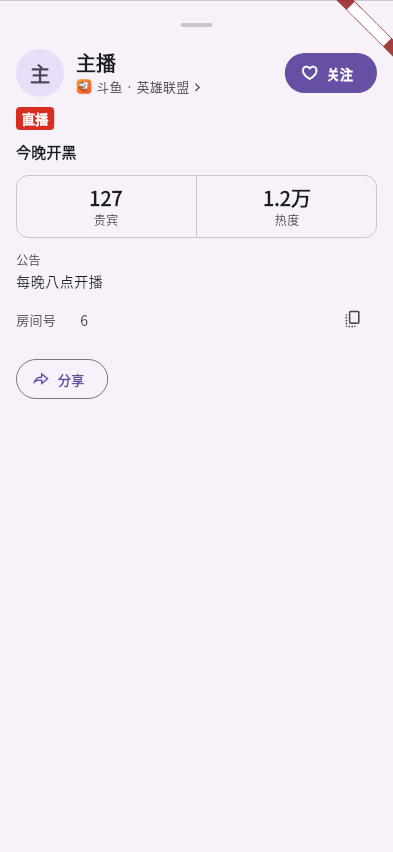
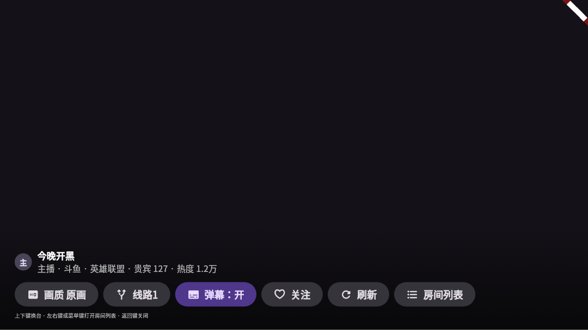

# 验证

协议样本、控制器和界面测试分层核对。原提交CI不能代替整合后的门禁，模拟数据不能当作原机验收；本次证据追加于Y01.32。

2026-10-29：82项手势/控制器组合、60项斗鱼协议回归通过。三个实际组件分别检查127更新到0，LiveRoom保持同一对象且真实在线人数未改变。信息栏“贵宾”通过Tooltip与语义标签提供，详情/电视显示可见标签；图为合成数据组件帧，不是真机。

