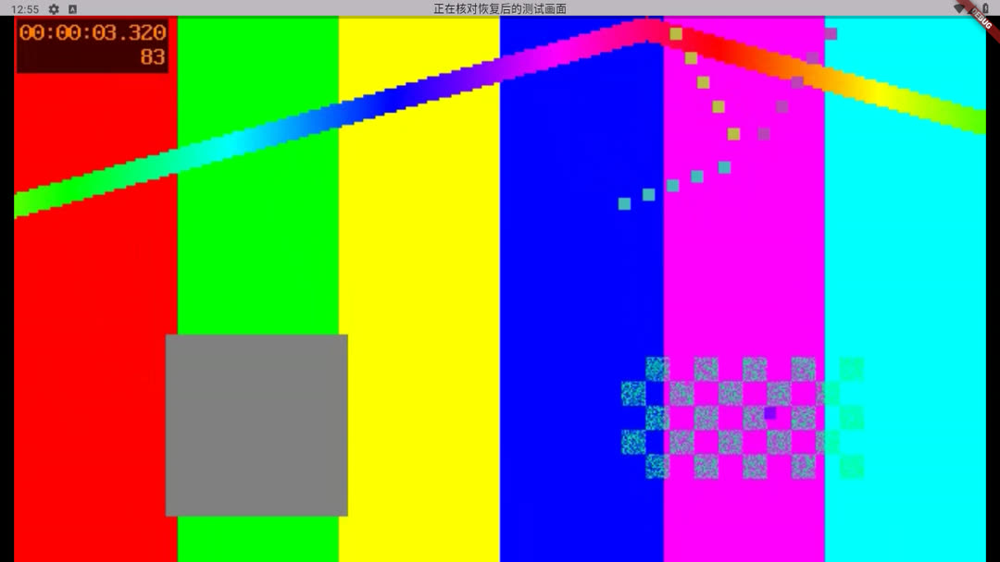
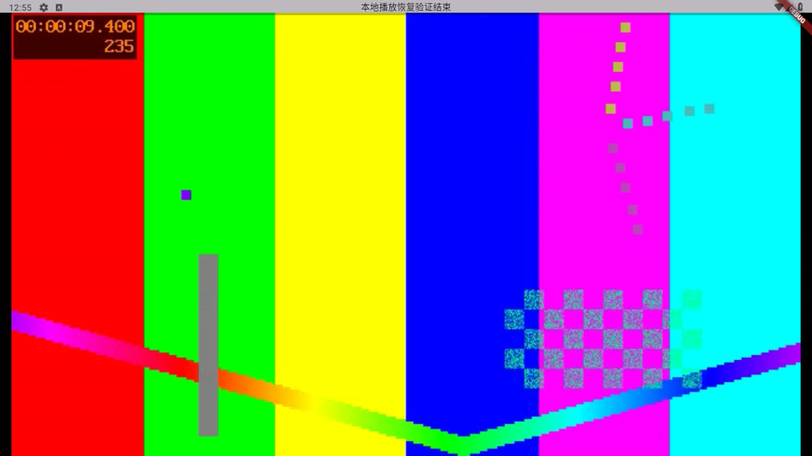
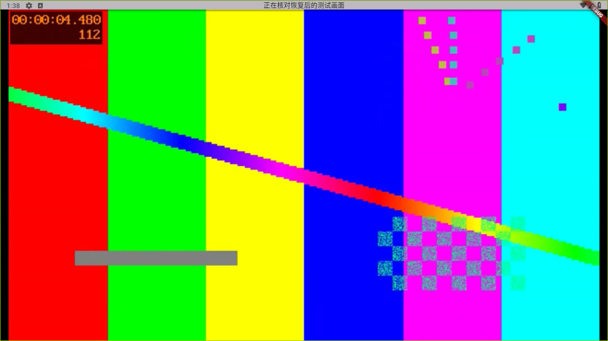
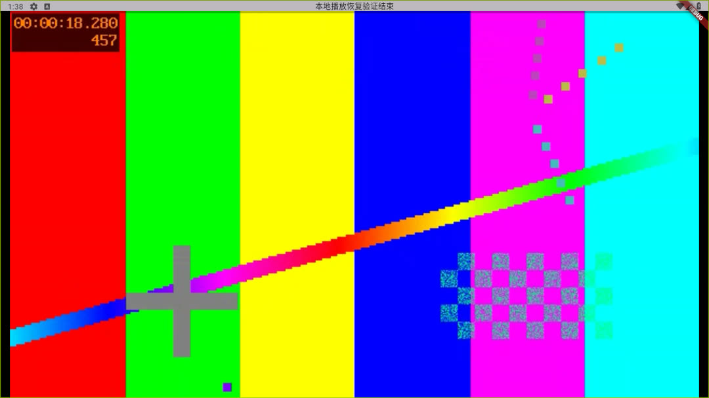

# Android 9原生验证

- 独立API28/x86_64模拟器；软件解码；生成H.264/AAC媒体和环回HTTP，未使用真实平台或物理设备。
- 基线普通404和短连接停顿后返回视频本来通过；未伪称原Sony现象已在基线稳定复现。
- 实际factory竞态、悬挂open、立即换房的音量排队、初始化超时有修复前失败记录。
- r3仅内核恢复时，内核像素截图有彩条、屏幕仍黑；新增Video controller身份key后的r4显示恢复。
- r4依次通过：冷启动视频、404后返回、连接停顿后返回、重复404后返回、长停顿触发一次内核替换后返回、连接中手动换线；两次内核创建，最后一帧之后仍推进到9.4秒。
- 音轨48kHz参数正常；模拟器禁用扬声器，未验收真实声音。
- 最终live_player 116项、包分析、两个fork修改文件分析通过；最终完整all/14与发行包证据见Y01.34。
- 原Sony v7a、Honor Kirin设备未复验；#49保持开放。

最终r5重复验证恢复链，并覆盖恢复后暂停13秒与主动继续；首轮r4图保留历史证据，最终图如下。

