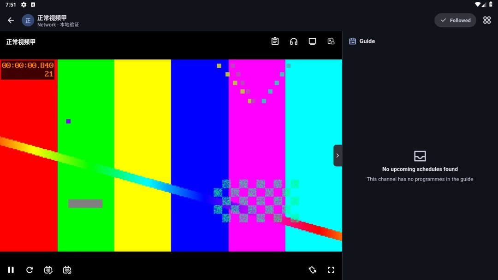

# 验证

源码`7c3136d04c96982be9b7252af985962b0829b314`，5.4.25+5129。同源Android9/API28/x86_64专用AVD，实际安装v4dev包回读SHA256与构建一致：`760ebd6e1f3926dcd89ab527a44e8582d8d521158dd5622f122851234c8eec71`。不是原用户电视/手机，不含可听的硬件音频输出。

普通切换直播间入口：生成视频甲→连接停顿乙→视频甲，先见实际彩色视频、停顿重连，再返回实际彩色视频。固定原生阶段记录仍为engine=1，健康复用保留；返回首页再开视频丁也有实际画面。未声称自然复现厂商原生卡死。测试后原有生成数据库按SHA256原样恢复，移除本轮reverse，停止AVD，测试前后数据与原始截图均保留在仓库外。

6项挂起/退役回归修改前失败、修改后通过；真实mpv配置失败清理计数0→1，原始异常保留；全部124项播放器测试、现代完整all/14门禁通过。源证据在仓库外`outputs/purelive-5425-20261031`，不将不同构建或模拟器结果换成原机验收。

#33/#49保留原Huawei/Sony/Honor设备验收，任务状态待真机。原设备首次失败所在的原生阶段仍需新版日志确认。
