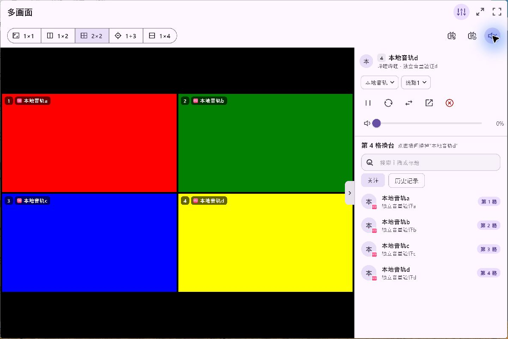
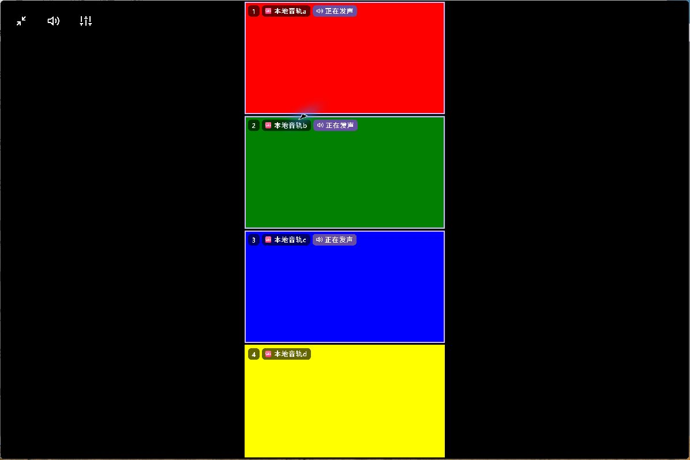
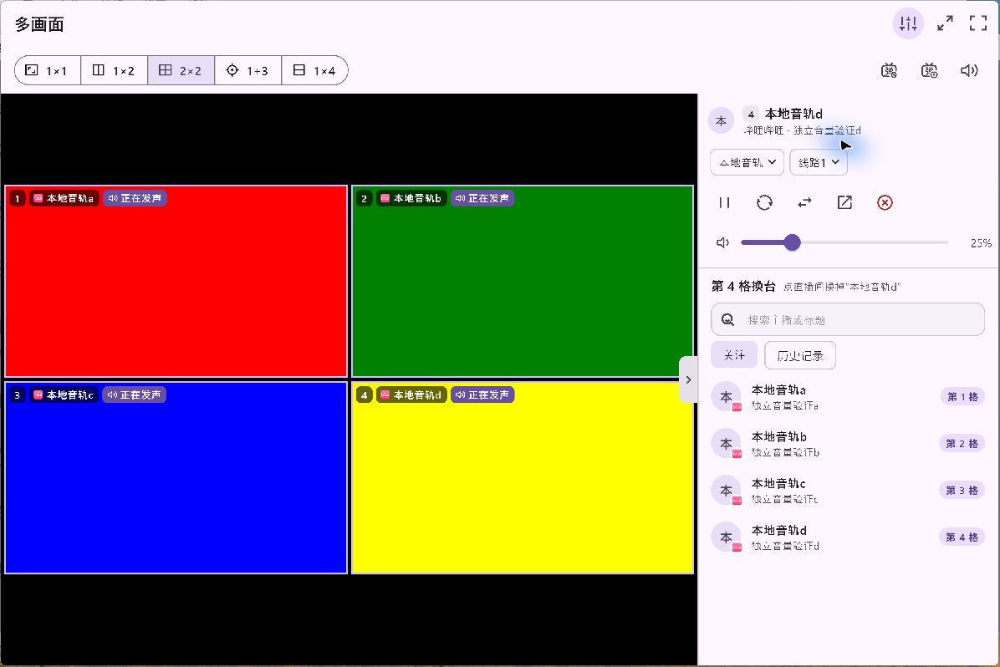
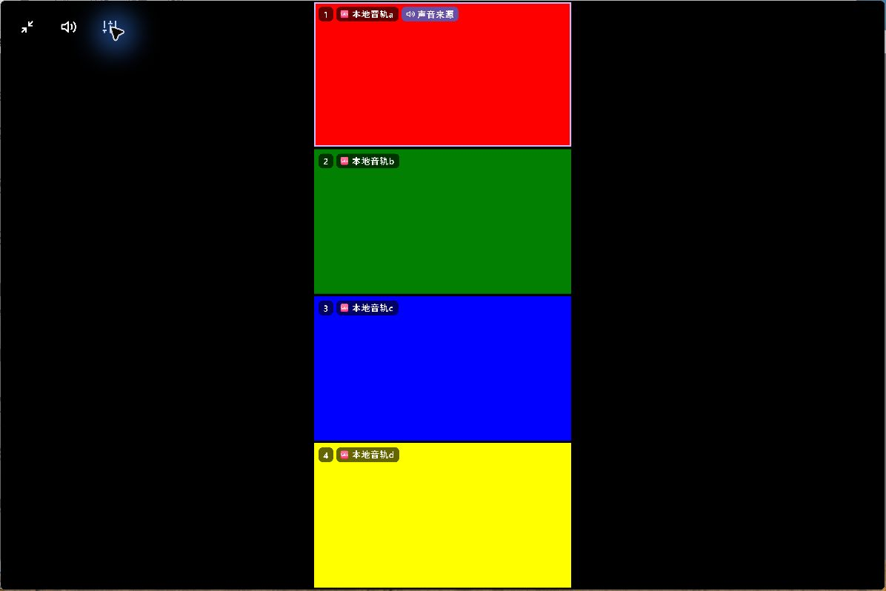
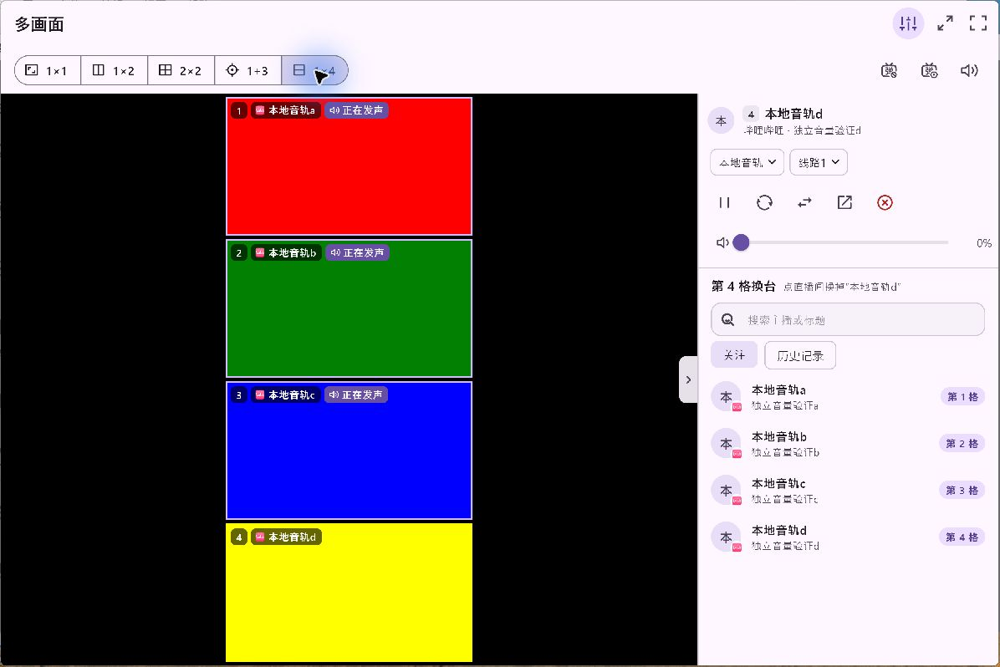

# 原生验证

Windows功能候选22f67af1068a35a00edfc2c20b05db729143819e，生产多画面页面、真实mpv、内存数据和四个本地生成视频。通过微软ApplicationLoopback仅采集验证进程树的输出；没有采集麦克风或其他应用。

七阶段通过：默认仅第四格1400Hz；开启混音后440/660/1000/1400Hz均存在；第四格由50%降至约25%时仅1400Hz幅度降低，其余三路保持；第四格降至0时仅该频率消失；全部静音四频均低于1e-5；四行布局保留三路和第四格零音量；沉浸模式关闭混音后只剩选中的第一格440Hz。振幅与哈希见verify/audio-spectrum.json。检查的是实际声音而非仅调用音量接口；音量百分比不是线性振幅承诺。

单格静音操作最初点到装饰图标、随后点到滑块外侧，均未改变音量；保留这两次采集但不计通过。拖动滑块至0后重新验证通过。验证进程已退出，正式安装和数据未修改。

全多画面59项、设置默认值测试通过；窄横屏和2倍字体覆盖。先前第四个工具栏按钮挤压布局，已移至顶栏；角标按剩余宽度和文字缩放决定紧凑显示。Android/Apple/物理电视尚不属于本条原生音频采集覆盖。

