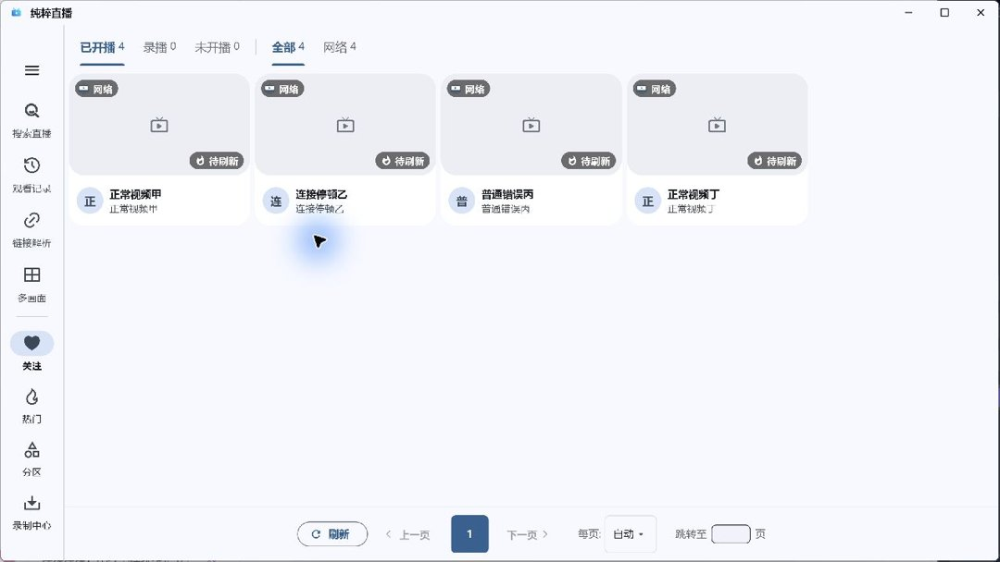
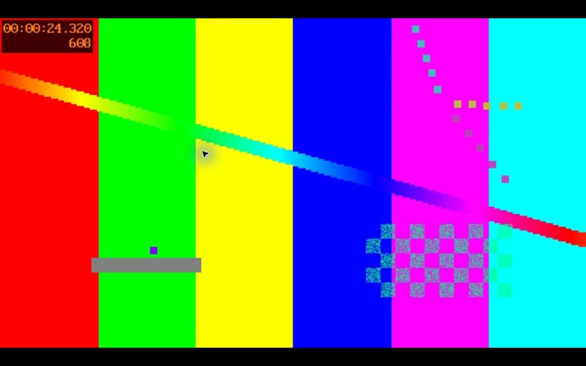

# 验证

源码`7c3136d04c96982be9b7252af985962b0829b314`，5.4.25+5129。最终Windows ZIP SHA256：`8345702f510a3eb2a135dc05df3bde5dc0578d08890c3666d6e6a8ddc00c55d8`。在独立目录以secondary instance运行，仅有四个生成频道；未导入正式数据或操作开机启动项。

两次可见启动都显示关注主页；验证最大化/恢复、按绘制位置点击视频卡片、实际视频、双击系统全屏、Escape恢复原窗口，以及系统菜单小幅调整宽度1276→1254后的清晰布局。两次均经应用关闭退出。测试机渲染为Impeller OpenGLESSDF，系统为Microsoft Windows NT 10.0.26300.0。保存的主窗口最大化恢复顺序由异步屏障回归覆盖，未以secondary instance冒称主窗口OS恢复验收。

首次后台SW_HIDE夹具按启动标志保持隐藏，日志已有firstFrame/home；该记录独立保留。后续两个可见交互启动使用Normal，未将隐藏窗口认作白屏故障。第一次指针边缘拖动未改变尺寸，真正小幅缩放通过原生系统菜单执行。

原GTX760、原Windows10、混合DPI多屏尚未取得；#47与本任务保持待真机。包、截图、恢复尺寸及日志摘要在仓库外`outputs/purelive-5425-20261031`。Windows恢复屏障回归旧异步callback行为失败、修复通过，现代all/14门禁通过。
