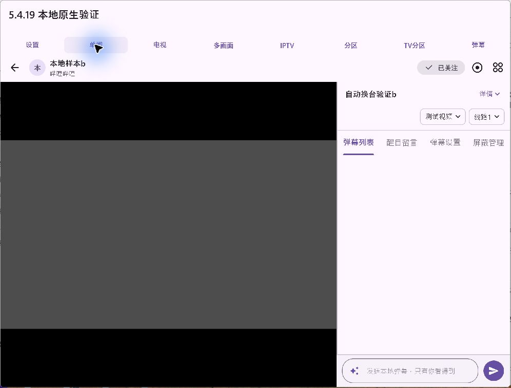
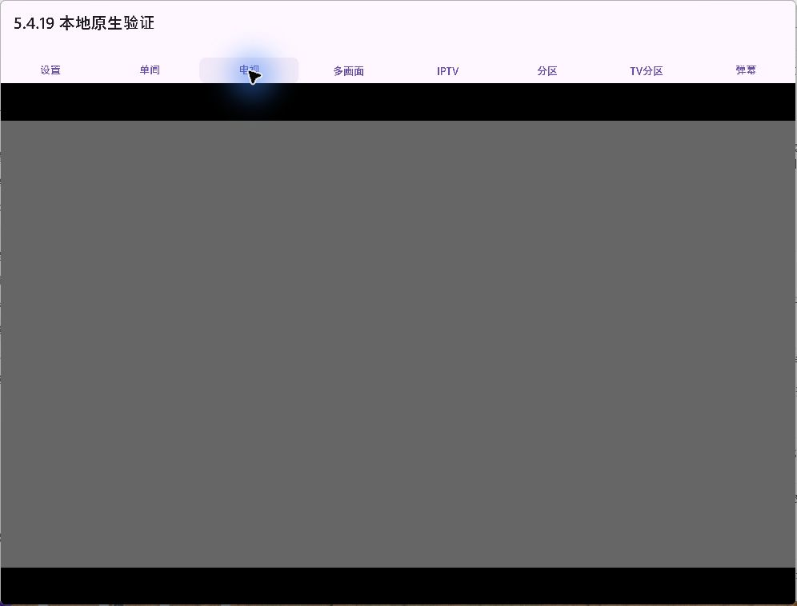
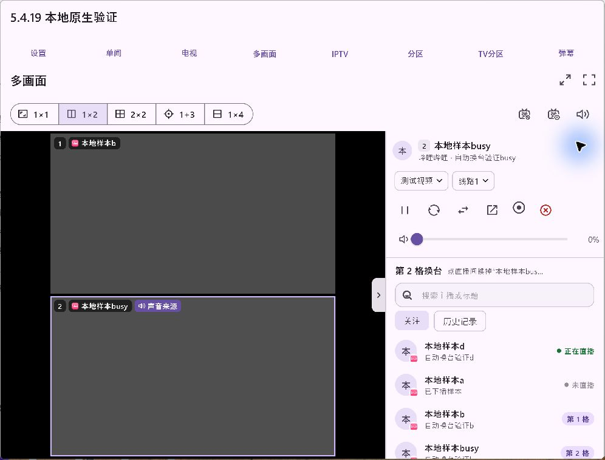
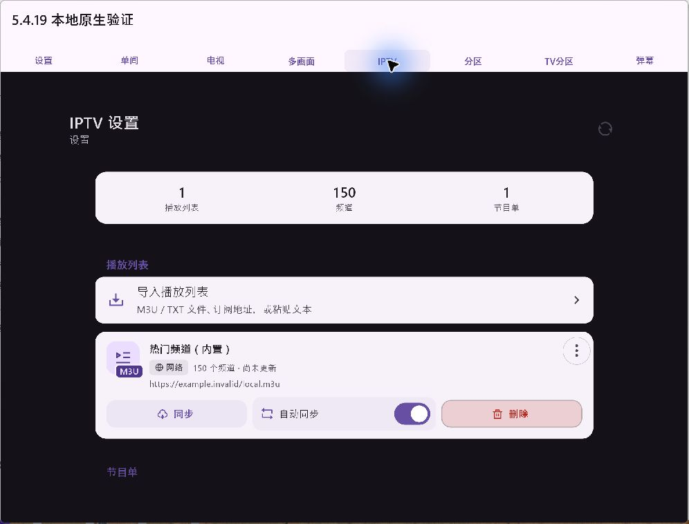
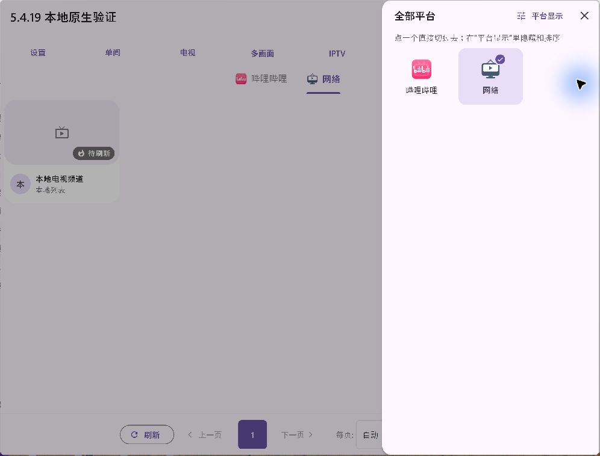
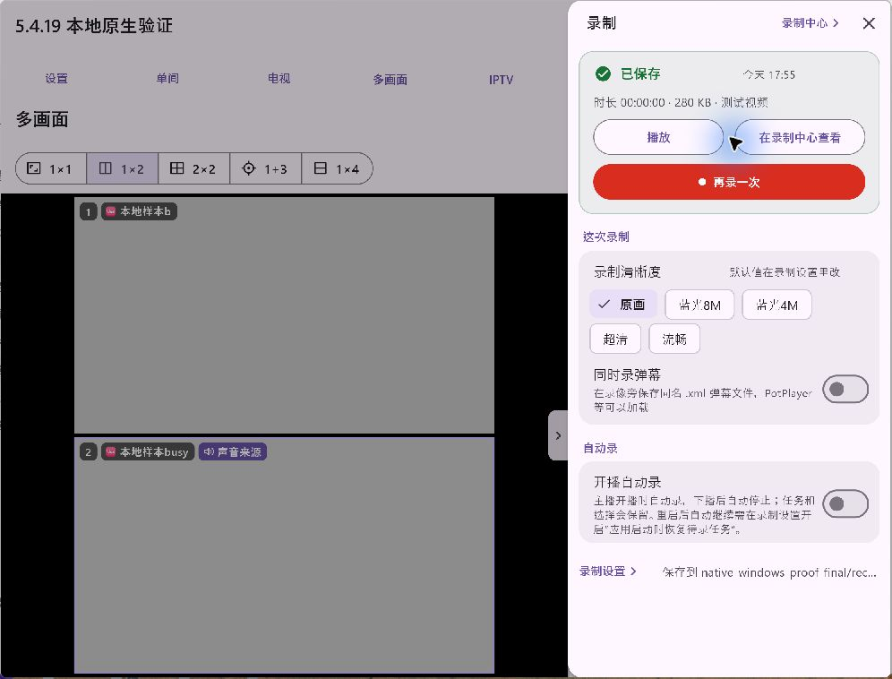
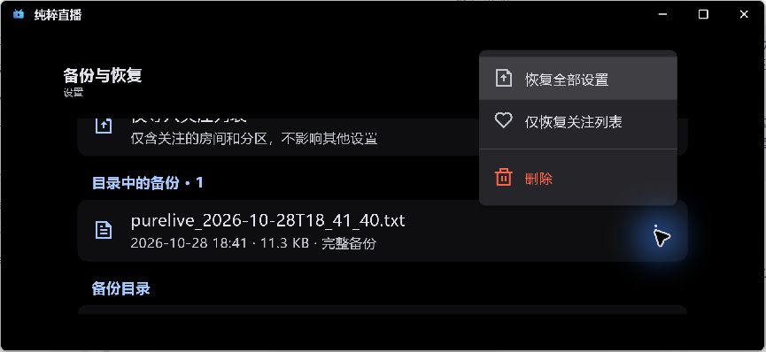
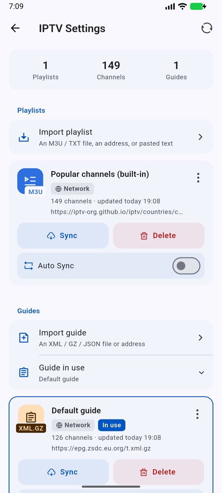

# 验证

构建源码 `8aa2e47164e4adbac90fff08c0a34cd149d2959d`，5.4.19+5123；修复合并 [PR #86](https://github.com/wzgrx/PureLive/pull/86)，保留贡献者 [PR #80](https://github.com/wzgrx/PureLive/pull/80) 原提交。门禁与原生证据区分如下。

| 范围 | 实际结果 | 限制 |
|---|---|---|
| 源码 | all/14完整门禁、严格分析、198项组合回归通过；改前失败日志保留 | 不代替原设备验收 |
| Android三ABI | 同源版本、证书、包名、16KB检查通过 | K90锁屏未安装或操作 |
| Android37隔离模拟器 | 正常v4dev包哈希匹配；直接进IPTV设置初始化149频道和节目单；原生mpv三布局换台、FFmpeg录制文件完整解码通过；结束时恢复正常测试包并关闭本任务模拟器 | x86_64模拟器不是原Sony/Huawei电视 |
| Windows | 正式ZIP五次冷启动进入首页；实际生产页面三布局换台；中键/右键在普通和最大化窗口往返；电视备份更多按钮方向键和回车可达；统计栏、平台首焦点、字号60和通知开关核对 | 更新页远程请求超时，数据一致性由回归验证；未覆盖原Win10显卡/显示器组合 |
| Linux | 最终tar包在隔离Xvfb启动，截图人工确认首页 | 非桌面长期交互验收 |
| Apple | 同源码构建40668580369成功；30张帧人工核对；两个macOS27.0.1 arm64节点启动同一最终ZIP共四次，5/30/90秒及关闭重开均显示首页；iOS模拟器启动和分享确认显示正常 | 原iPhone/iPad硬件未测；最终ZIP的menu命名帧没有展开菜单，仅证明渲染保持 |
| 原生录制/播放 | Windows与Android生产FFmpeg适配器输出合成MP4并完整解码；iOS/macOS原生录制核心WAV独立解析；Mac真实播放进度及最小化策略通过 | 合成静音片段不代表真实长时间直播录音；iOS手势目前是回归证据 |

Windows首次测试入口出现白帧，随后正常启动；后来捕获工具曾返回非目标画面，已停止输入、移除无关截图并重新绑定正确窗口。单张白帧根因仍未确认，不新增一像素抖动等引擎补丁，不宣称#47解决。

K90处于锁屏，按用户自主决策授权改用隔离模拟器与Windows原生验证，本次不阻塞其余平台发布；原机相关任务保留待真机状态，不宣称已获新的人工单次批准。

## 界面证据

安装包与本地证据摘要见[证据清单](verify/evidence.json)。公开下载和双库更新收尾补记于record.md。
