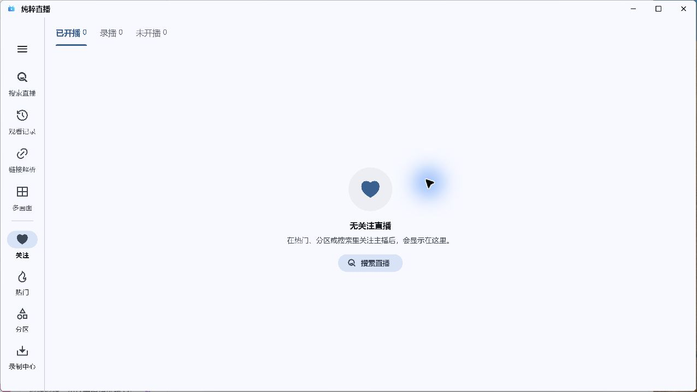
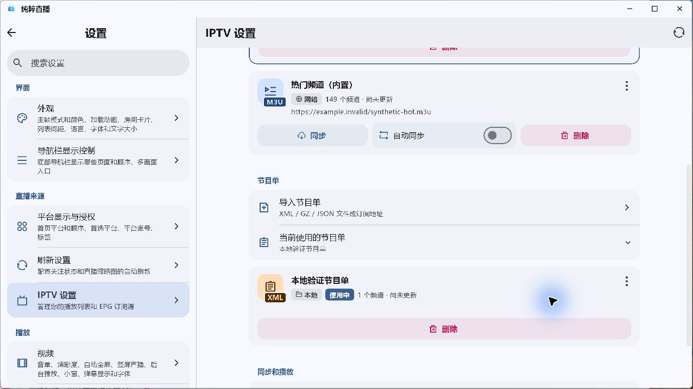
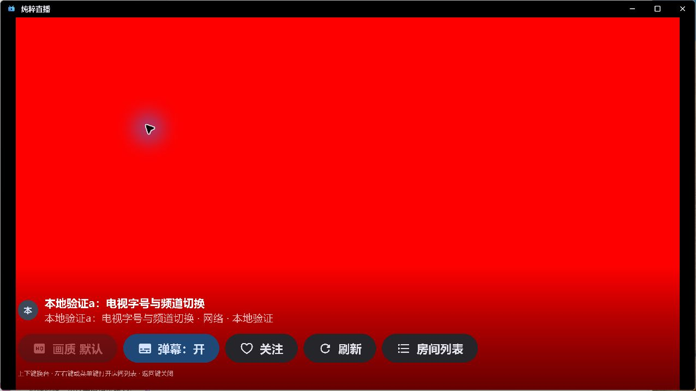
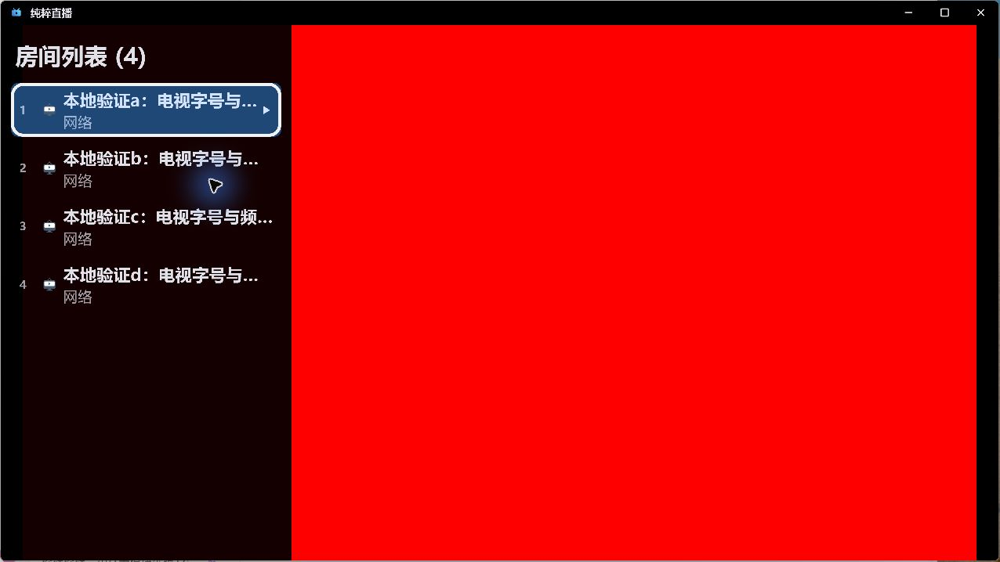
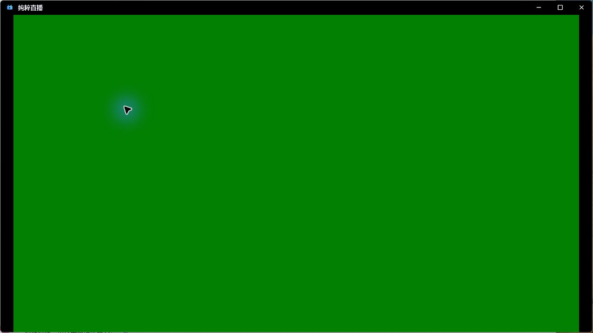
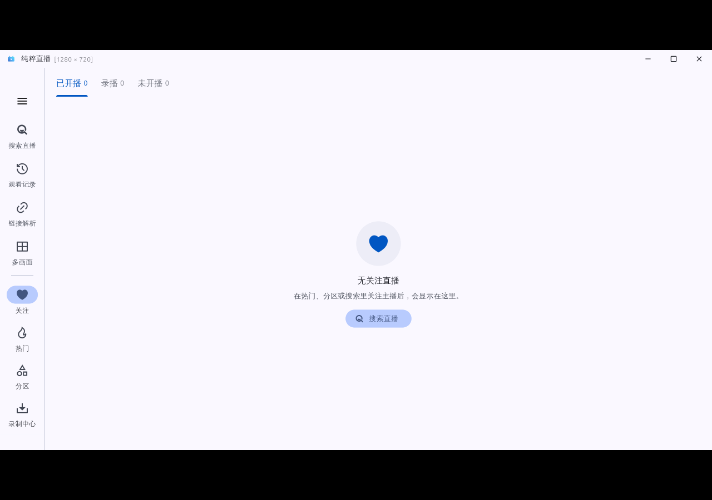
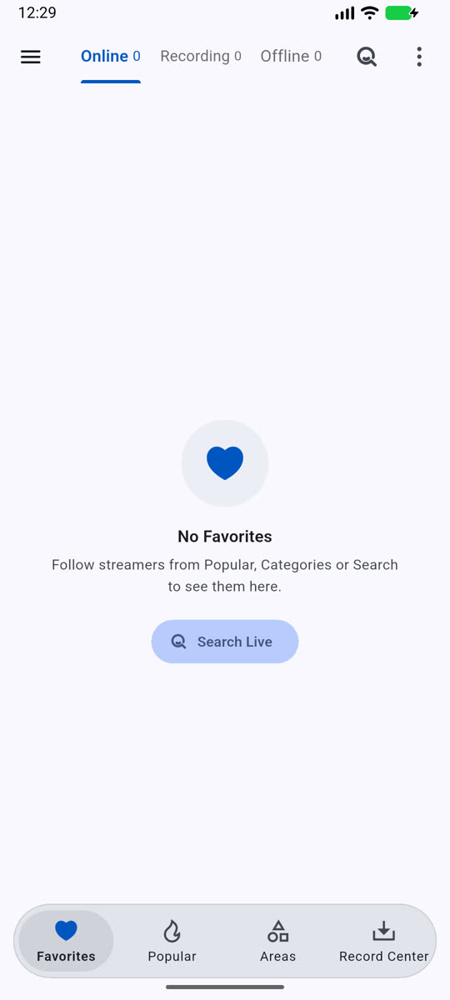

# 验证

构建源码 `27d6465798d9bc2098e9a5c5e5c7154984096522`，5.4.20+5124；[PR #92](https://github.com/wzgrx/PureLive/pull/92) 已合并。测试、原生运行和原设备验收分别记录。

| 范围 | 实际结果 | 限制 |
|---|---|---|
| 源码 | all/14 完整门禁通过；多画面59项、微博194项、IPTV与电视107项及新增9个字号/尺寸用例通过 | 单元测试不代表所有设备表现 |
| Windows真实声音 | 生产多画面页面和mpv，四个440/660/1000/1400 Hz合成音源，经应用专属回环采样验证单路、四路、独立音量、零音量、全部静音、四行与沉浸切换 | 音频预验源码22f67af，最终27d仅另增电视样式与诊断；原音频实现未变。未采集麦克风或其他应用声音 |
| Windows最终包 | 正式ZIP一次普通冷启动进入首页；节目单保留使用中且无常驻描边；电视直播控制栏与列表可读，方向键选台后实际从红色视频切到绿色 | 非五次冷启动；未覆盖原Win10显卡、混合DPI和用户备份环境 |
| Linux最终包 | 隔离Xvfb启动截图人工确认首页 | 非长期桌面交互验收 |
| Android三ABI | 同源版本、证书、包名与16KB检查通过 | 未操作K90或原电视 |
| Android37隔离模拟器 | 四个实际mpv会话播放超过8分钟；六阶段音量状态、横竖屏、四行及沉浸控件检查通过；恢复正常5124测试包并关闭本任务AVD，数据保留 | 模拟器使用-no-audio，不作为真实声音输出证据 |
| Apple | 同源运行40714096775成功；30张正常启动帧人工核对；两个macOS27.0.1 arm64节点启动同一最终ZIP，5/30/90秒和重开均显示首页；iOS模拟器首页及分享确认正常 | 最终ZIP的menu命名帧未展开菜单，仅证明持续渲染；主构建截图另有Edit菜单。iPhone/iPad硬件未测 |
| Apple原生 | iOS/macOS录制核心两份静音WAV独立解析；Mac原生播放进度、遮挡和最小化策略通过 | 三张原生画面为灰色/遮盖/销毁后的黑色，不能称视觉帧持续推进；合成静音录制不代表真实直播音频 |
| 微博实际线路 | 匿名Dart适配器取得四档；ffprobe核对HEVC1080×1920、AVC1080×1920、720×1280、480×854 | 可用清晰度随直播源变化；探测读取有限FLV头，不等于每个设备完整解码 |

## 失败尝试及边界

早期多画面工具栏和大字号徽章溢出先有失败回归，修复后通过。Windows两次最初点按未命中实际音量轨道，未计入成功证据；修正轨道操作后才采纳对应音频采样。正式Windows安装及用户数据未操作。

Android测试前出现SystemUI无响应提示；私有AVD上处理后继续。首次传输媒体末尾丢失211字节被哈希发现，改用无TTY传输后逐文件一致。初始辅助测试APK编入旧的外部路径，日志为PathNotFound；从同一冻结源码重建正确私有路径测试入口后完成验证，十个正式安装包没有因此改变。原失败日志保留，没有将测试夹具错误称为产品已修复的问题。

旧库首次基线因原生依赖下载中断而未进入应用测试。归档摘要匹配冻结清单后重新完整检查；原失败保留，后续基线与候选结果另记于record.md。

#49反馈清数据后恢复、跨平台切换后再次黑屏；日志首帧后进入缓冲/播放停滞。当前没有确认解码器或Surface根因。默认INFO以前过滤了缓冲采样，本次将固定数字/布尔采样接入日志，不含URL、请求头和账号。#33/#47/#49继续开放。

## 最终包界面

包摘要与本地证据摘要见[证据清单](verify/evidence.json)。原生音频采样证据另见[V01.12](../../../V-需求和反馈/V01-新功能提议/V01.12-多画面同时出声和独立音量/verify.md)。
