# 5.4.21验证

源码`e3c263ccfd6677baf66570b038e16ccb6fdacbcd`，构建号5125；[PR #99](https://github.com/wzgrx/PureLive/pull/99)已合并，十包与校验文件同源。原失败日志保留，源码all/14完整门禁通过；公开11个文件匿名下载的字节数、SHA-256及完整性清单复核通过。

测试、最终安装包运行与原反馈设备验收分别记录。本次未操作 K90、用户正式 Windows 安装或任何真实账号。

| 范围 | 已验证结果 | 未覆盖或限制 |
|---|---|---|
| 源码 | 完整 all/14 门禁通过；手势/控制器、斗鱼协议、贵宾组件更新、播放器弹窗和电视相关回归通过。新增电视输入使用真实回环 HTTP 表单与 TV 路由；电视和手机输入整组 47 项通过 | 相关测试组有重叠，不累计成一个新的总测试数 |
| 主页箭头 | Android 37 隔离实例使用 80 个生成频道，实际滚动后两个箭头位于标准玻璃底栏上方；点击分别返回顶部和到达底部 | 紧凑、平板、安全区、导航隐藏状态由既有 105 项相关回归和合成帧覆盖，未在本次模拟器逐一操作 |
| 原生手势 | 同源正常 v4dev 包在竖屏全屏播放本地 H264 视频。左右两侧横滑夹带纵向偏移时，媒体音量保持 5/15、窗口亮度保持默认。右侧竖滑使原生音量 5→9，亮度不变；左侧竖滑使窗口亮度变为 0.15，音量不变 | 原生检查限 Android 竖屏；横屏及 iOS 的方向组合由组件回归覆盖。模拟器禁用声音输出，音量状态不是实际声音采样 |
| Android 电视输入 | 横屏电视模式中，方向键到达手机输入，确认打开表单；返回取消后恢复按钮焦点，再次确认可重开。向实际应用表单提交生成的多行分享口令后，打开“本地验证频道 01”，视频内时间从 6.8 秒推进到 63.8 秒 | HTTP 通过该私有模拟器的临时 ADB 转发测试，没有验证物理手机摄像头或跨设备局域网连接；临时转发随后移除 |
| Android 包与恢复 | 三个正式 ABI 的版本、包名、证书与 16 KB 对齐检查通过。同源 x86_64 正常 v4dev APK 安装哈希复核；备份原数据库及 WAL/SHM、核对摘要，再通过 SQLite API 合并备份。验证后恢复原数据、原竖屏界面和媒体音量 5，重新核对正常 5125 APK 后关闭私有 AVD | 未在正式包或原 Huawei/Sony 电视上安装；arm64 测试包只构建，未操作实体手机 |
| Windows 最终包 | 最终 ZIP 在独立生成数据目录进入首页；电视链接输入入口和方向键聚焦可见；实际应用的本机 HTTP 表单 GET/POST 接受生成的分享口令 | 首次 LAN 服务触发 Windows 防火墙提示，遮挡后的取消及跳转画面未计为通过；没有操作安全提示或修改系统网络权限。EXE 安装包仅做封包和摘要检查，未覆盖用户现有安装 |
| Linux 最终包 | 最终 tar 在独立 Xvfb、独立配置与数据目录启动，人工查看截图确认进入首页 | 非真实桌面会话的长期交互验收 |
| Apple 最终包 | 同源运行 40760169821 成功；人工查看全部 30 张正常启动帧。两个节点四次启动同一最终 Mac ZIP，5/30/90 秒及重开均显示完整首页；主构建的 Mac Edit 菜单可见；iOS 模拟器首页及 URL 打开确认可见 | 最终 ZIP 的 menu 命名帧没有展开菜单，仅证明持续渲染；未操作原 iPhone/iPad/Mac 硬件 |
| Apple 原生 | iOS/macOS 两份静音 WAV 独立解析，格式和样本符合预期；Mac 原生播放位置、遮挡及最小化/恢复策略结果通过 | 三张原生帧为均匀深灰、遮挡黑色、会话销毁后的黑色，不据此宣称画面持续推进。原生入口与完整发布应用交互不同，合成静音录制也不代表真实直播音频 |
| 斗鱼贵宾 | 协议和控制器分别验证独立事件/会话数值、零值、换房、关播及晚到事件；信息栏、详情、电视组件验证 127→0 且 LiveRoom 与真实在线人数不变，三张合成帧已查看 | 未在本次原生设备中直接观察真实直播贵宾数更新；不把合成组件帧当成原生运行结果 |

匿名平台巡检保留原始结果：哔哩哔哩、斗鱼、虎牙各 13 项正常；抖音 12 项正常、1 项不支持（搜索主播）。快手 12 项正常，三个房间各 5 秒未收到聊天，P13 记为失败。随后一次有上限的观察中，原房间 30 秒仍无聊天，但另一个在播房间在 30 秒收到 1 条聊天、10 次人数更新，无重连或错误。后续观察证明至少该房间的接收和解析可用，不覆盖原失败，也不证明原房间安静的具体原因。未保存聊天内容、登录账号或发送平台消息。

保留的失败与修订：第一候选在排队中的贵宾消息复现关播后重新出现后停止，没有构建旧候选包；修正后再次冻结。完整门禁发现两项旧整页测试忽略起始 20 像素，新方向识别统一从按下计算位移，改用精确 20+40 像素和每帧一次的断言后通过，不放宽误差。电视输入夹具的类型、HTTP 测试区异步等待和退场动画等待问题另行修正，原日志保留，不作为产品缺陷计数。

原生验证辅助过程也分别记录：私有模拟器安装新包前出现 System UI 无响应提示，核对后选择“等待”；首次全屏的系统使用说明核对后关闭。自动隐藏的播放器控件让最初几次点按仅显示控件，这些尝试未计为全屏验证；随后通过当前无障碍标签进入全屏。图片工具遇到本机默认 Python 与 Pillow 扩展版本不匹配，改用已安装的系统 Python 3.14 处理图片，没有修改项目 SDK 或全局 Python。Windows 首次退出确认出现辅助进程检查时序问题，修正退出等待后重试；额外启动没有计为界面验收。模拟器清理时发现 shell 设置音量未改变实际读数，改用测试实例前台的音量键并逐次读回 8、7、6、5，确认恢复后才关闭。

#33、#47、#49 的原设备问题继续开放。本版交付已验证的修复与 #98 功能，不宣称这些原设备问题已经解决。#96 按维护者明确决定不实现，也没有新增真实平台弹幕发送。

旧库额外计时失败保留在完整门禁原日志中：基线6项、候选7项。新旧JSON的JD单项均通过，1200ms受控静默复现同一Too many elements机制；原失败具体调度间隔未测量。现代库另发现该虚拟时钟用例独立运行会等待SDK共享取消Future；替身改为自身onCancel Future后原断言通过，随后运行整文件和完整门禁。仅测试代码变动，安装包应用代码仍为e3c263c。机制参考[Dart SDK stream_impl](https://github.com/dart-lang/sdk/blob/main/sdk/lib/async/stream_impl.dart)及本机3.13.7源码；不把测试替身问题描述为发布应用故障。

旧归档库完整基线6项失败，候选7项：保留6项历史版本页失败，另有旧JD真计时测试失败。两种更新数据下单项均通过；可控1200ms静默复现原故障机制，但未测量原失败时的调度间隔。现代库原先已有虚拟时钟测试，本次另外修复其单独运行时替身取消Future跨区等待的问题，原断言未放宽。兼容、选包、版本比较及全部212条历史保留通过。用户已委托自主维护决策，D-074只覆盖本次两份JSON同步，不是新的人工单次批准，也不豁免现代库完整门禁。

## 最终包界面

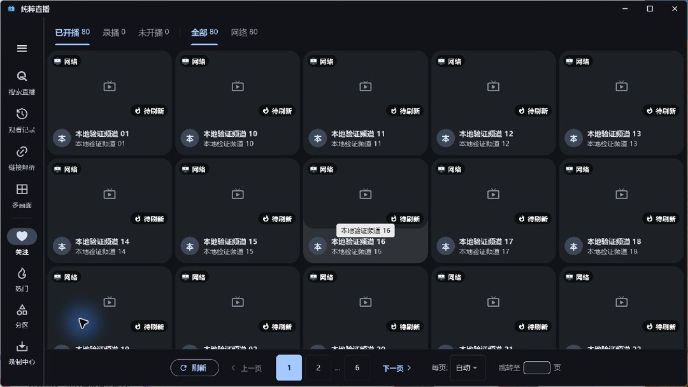

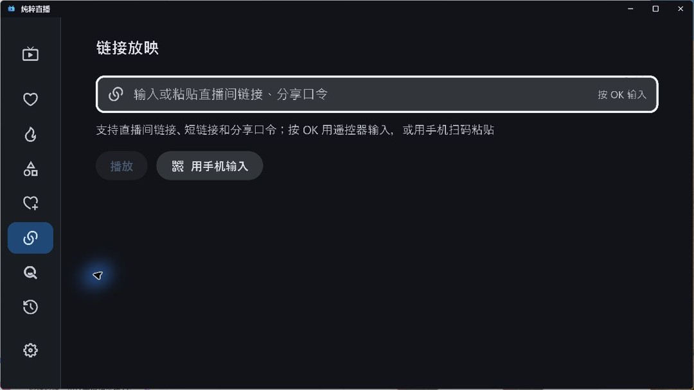

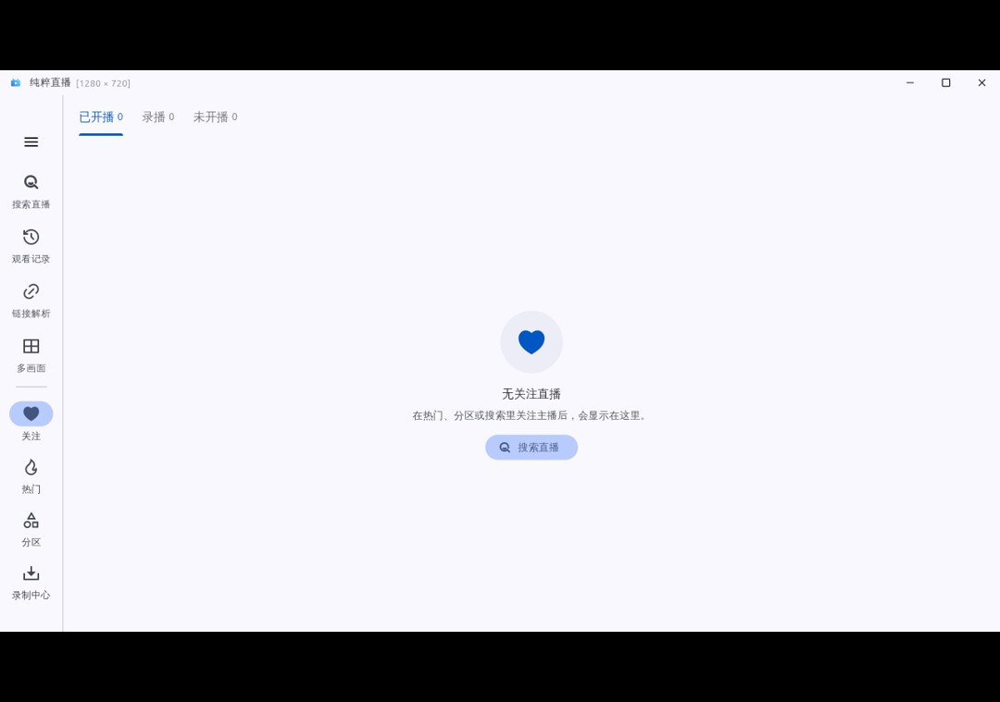

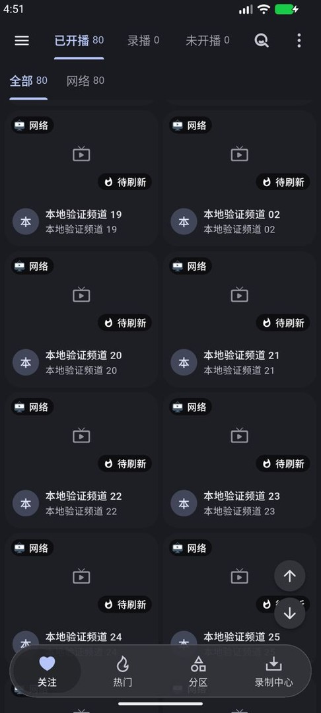

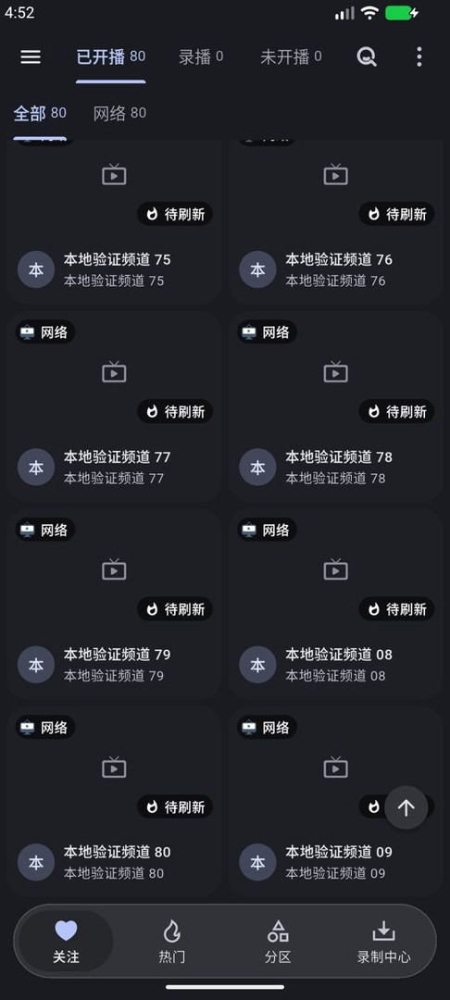

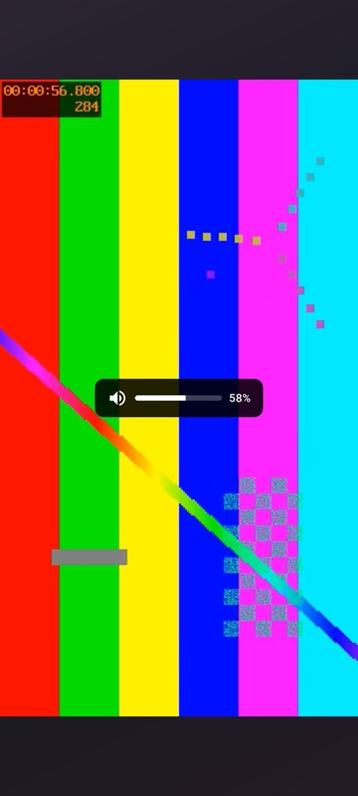

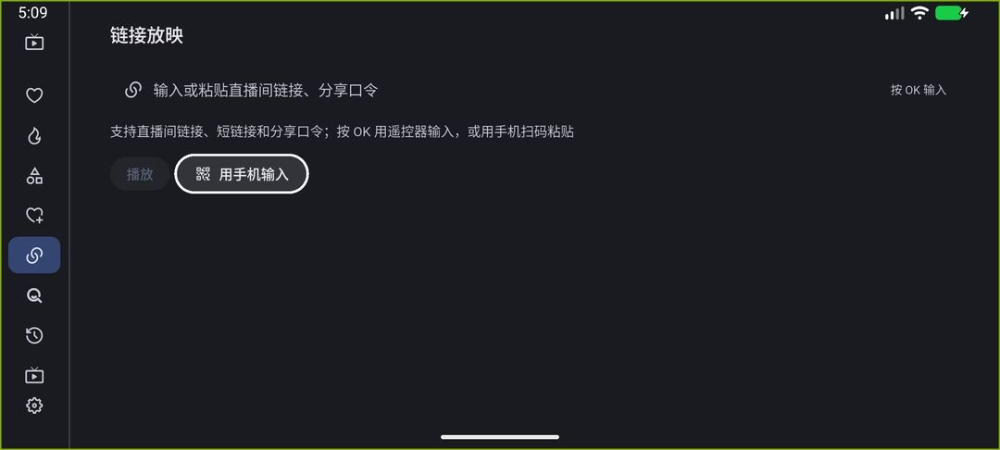

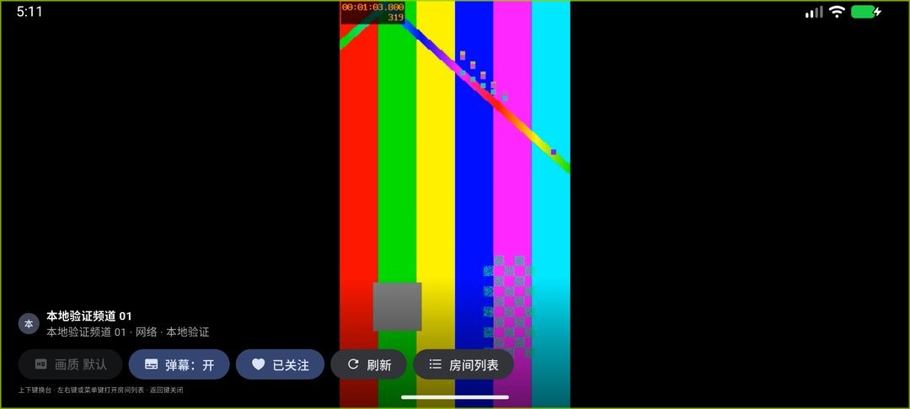

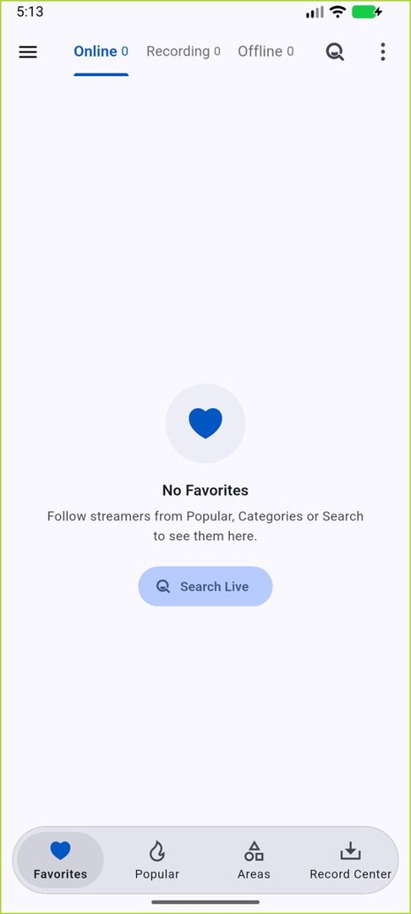

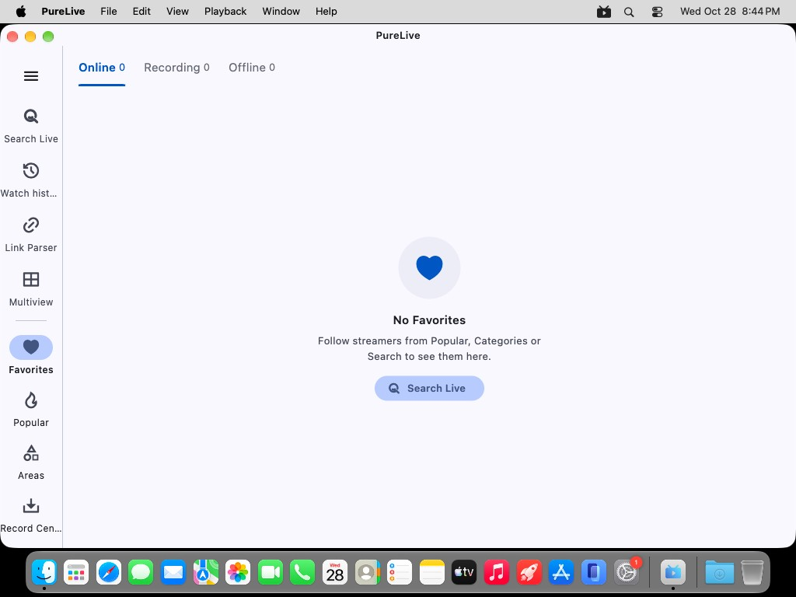

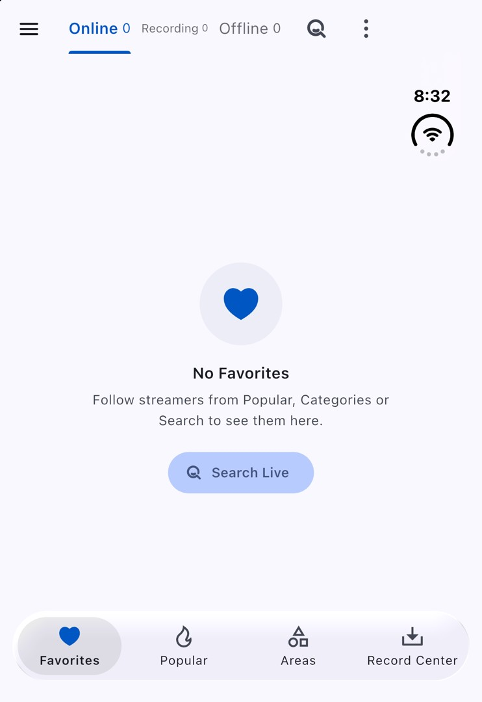

[证据摘要与包清单](verify/evidence.json)。
