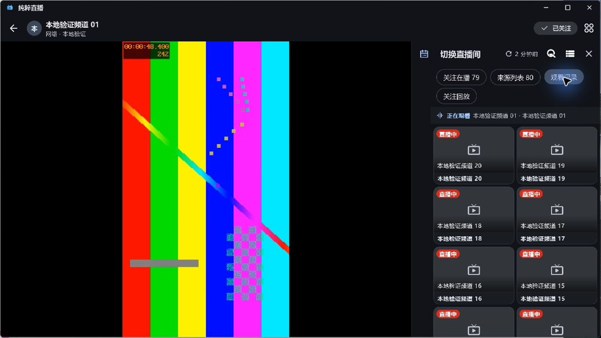
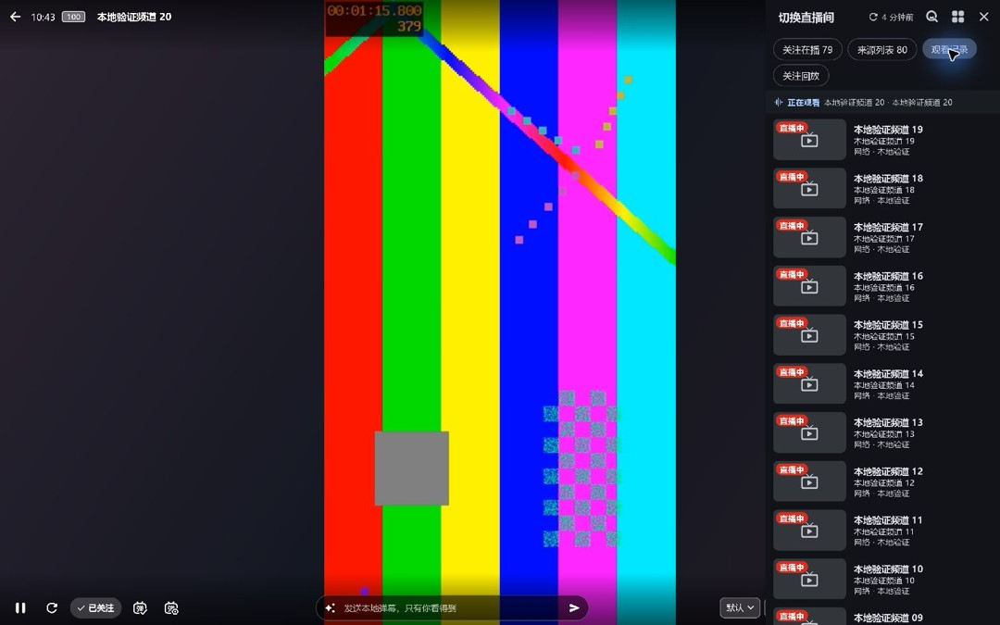
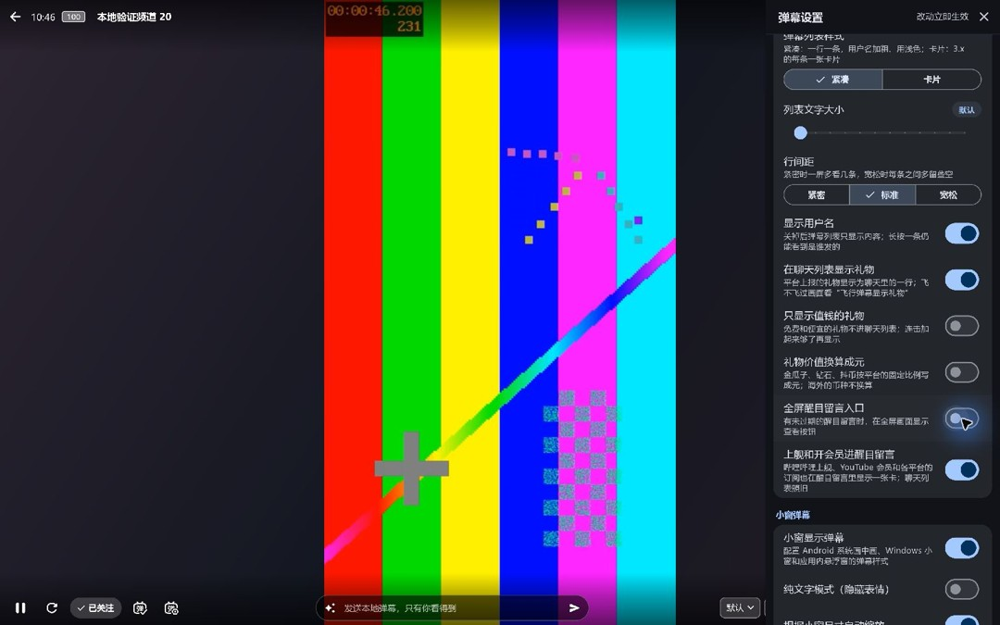
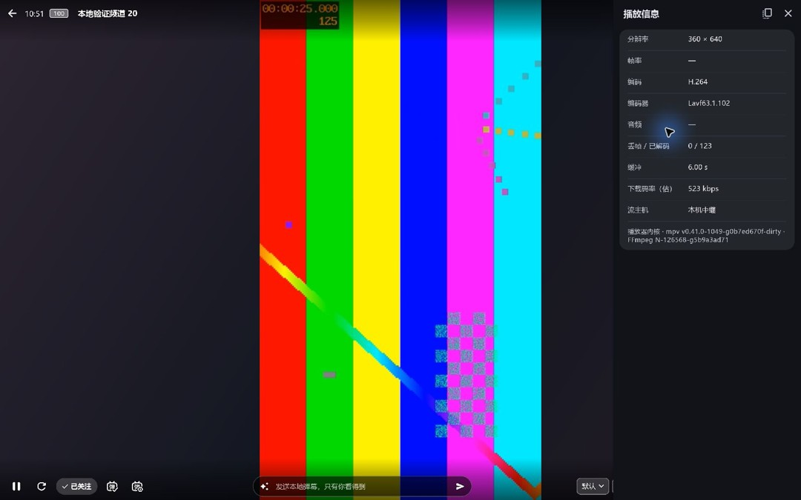
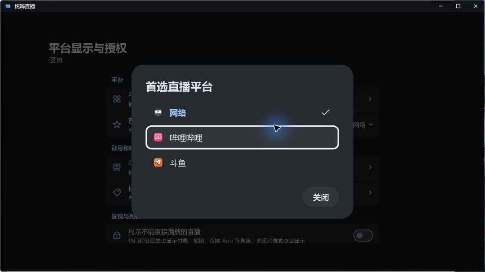
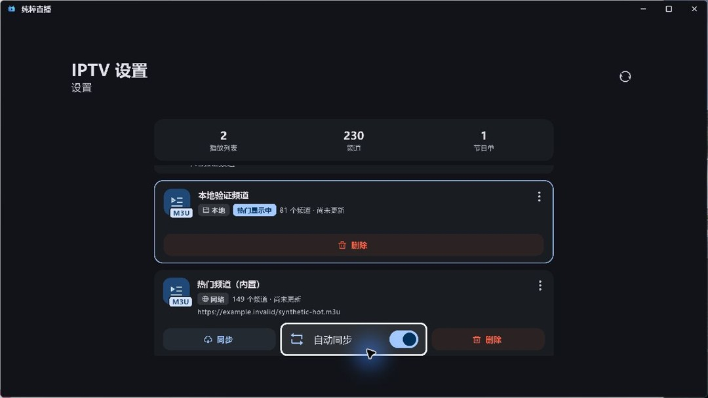
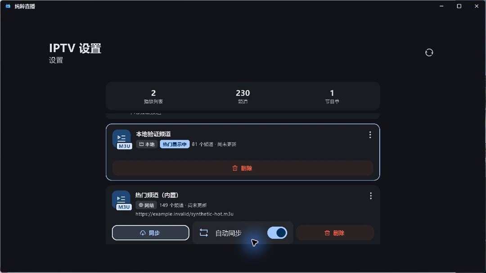
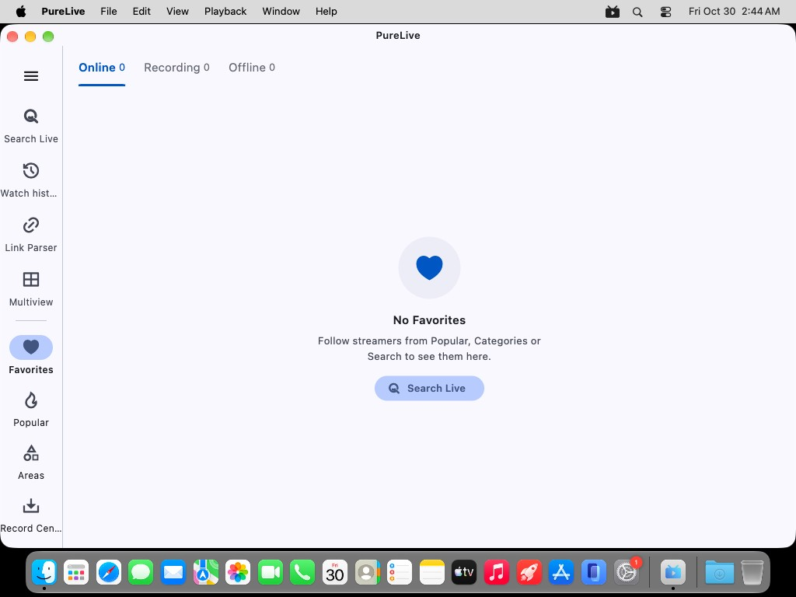

# 5.4.22验证

源码`4e3eff5c3f0404011fbedc73b277724f8b21f001`，构建号5126；[PR #111](https://github.com/wzgrx/PureLive/pull/111)已合并，保留PR#107原提交。十包与校验文件同源。原失败日志保留，最终源码all/14完整门禁通过；公开11个文件匿名下载的大小、SHA-256及完整性清单复核通过。

最终 Windows portable 包以独立生成数据实例运行。普通窗口 1280×720 和系统全屏 1536×960 的切换直播间四个分类均在面板内完整换行；20 条预置观看记录的宫格/列表、点击房间和回放空态已操作验证。醒目留言开关关闭与重开均写入 SQLite，并在再次启动后保留开启。播放信息实测显示 360×640、H.264、解码帧数、6 秒缓冲、估算下载码率及本机中继；生成视频无音轨且仅 5 fps，音频和帧率显示占位符合当前实现。电视模式首选平台的网络、哔哩哔哩、斗鱼图标与焦点可见。网络播放列表的自动同步按 Enter 开启和关闭、完成异步保存后均保留整行唯一焦点，分别一次 Left 到同步、一次 Right 到删除（未激活删除）。本次修复前同一路径曾出现焦点丢失，原失败证据保留；控制保存延时及忙碌时重复 Enter 的覆盖由增强回归测试提供。17 张本次截图已逐张查看；两次测试进程和本地生成视频服务已按精确身份关闭，正式安装与用户数据库未访问。未验证原生平台的付费醒目留言事件、实体电视遥控器或 Android 手机；这些范围不由 Windows 操作结果代替。

逐张查看本次 30 张 Apple 界面图和 3 张原生播放探针图。iOS 首页及链接打开确认框正常；Mac 主构建菜单展开、关窗和重开正常。两台云端 Mac 的最终 ZIP 各启动两次，四次在 5、30、90 秒及重开后均显示首页；menu 命名帧未展开菜单，仅证明持续渲染。原生探针可见帧为均匀深灰，遮挡帧带测试文字，恢复图摄于会话销毁后，不能单凭截图证明画面连续推进。原报告 Apple 真机及持续真实平台播放未覆盖。

passed: 最终Linux tar在Xvfb中显示中文首页、空关注和导航；本次已查看截图，不代表完整桌面交互或原反馈硬件验收。

平台巡检来源为首轮7887d17候选；新候选仅修界面焦点，平台/弹幕/网络/巡检源码树已逐项确认完全相同，因此保留并引用原网络观测，不伪称新候选重新联网全测。平台巡检保留原失败：哔哩哔哩、虎牙主要检查通过，抖音主播搜索为不支持；部分直播线路有404/超时而同房间其他线路可用。斗鱼首次房间搜索返回kw不能为空，但请求非空，独立同接口三种关键词及当前同版本适配器复查正常，原因未证实，不能称为代码已修复。快手初次5秒及后续30秒三个房间采样均无聊天，人数持续上报；进一步15秒抓取的5次原始响应均HTTP200/result=1，liveStreamFeeds本身为空、游标/人数存在，解析后亦为空。只保留字段名与数量，不保留聊天正文或令牌。不能据此认定匿名限制、服务器故障或本地解析错误，仍属未解决巡检项。本版不把这两次巡检改写为全通过，也不将它们算入桌面界面修复成果。

旧归档库本次完整基线和最终候选为相同六项历史版本页失败，无新增。旧客户端解析、版本比较、平台选包和全部213条历史保留通过。D-075仅覆盖本次两份JSON同步；决定来自用户既有自主维护委托，不是新的人工单次批准，不豁免现代库完整门禁。现代库收尾完整门禁和合并后四份公开更新文件匿名复读继续执行。

## 最终包界面

[证据摘要与包清单](verify/evidence.json)。
