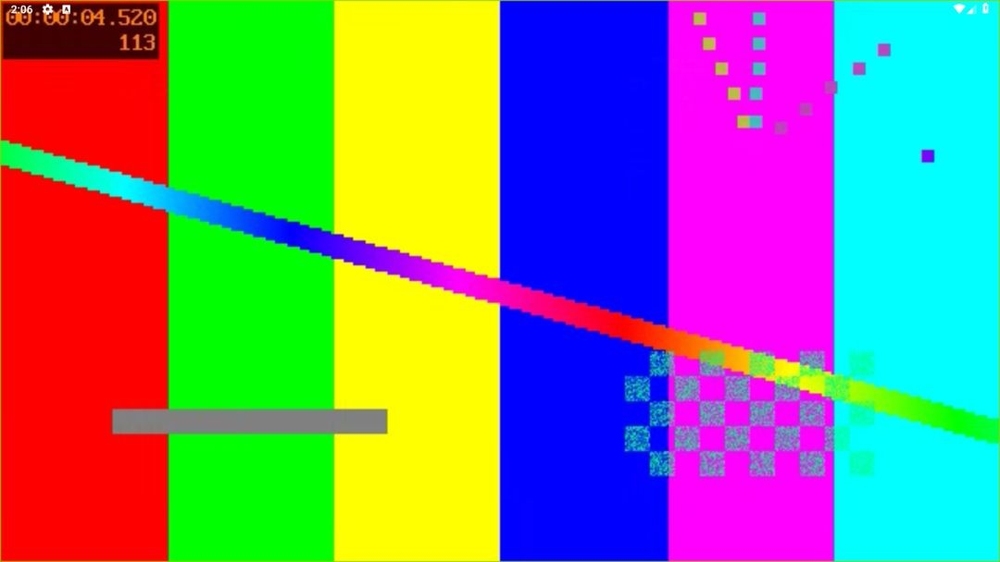
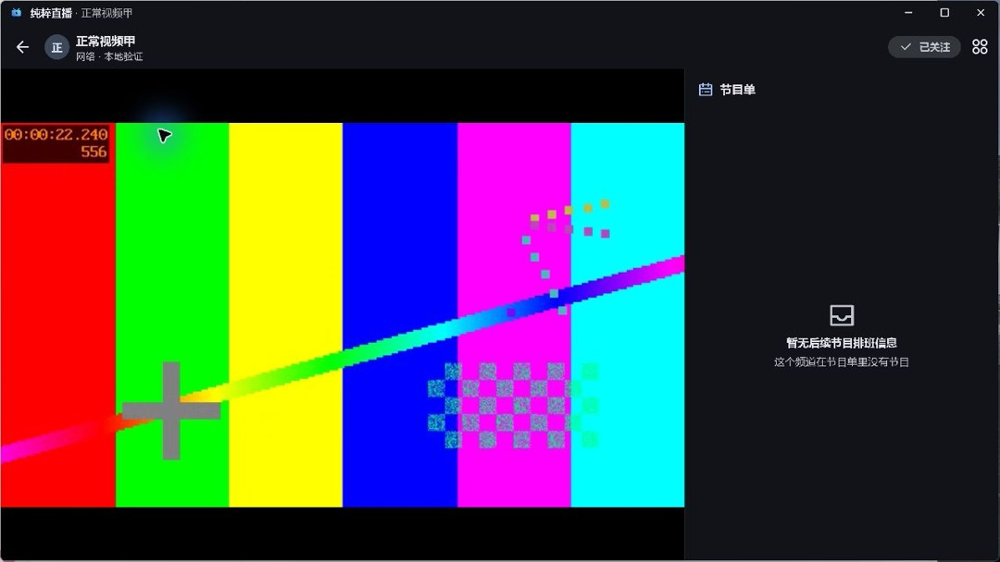
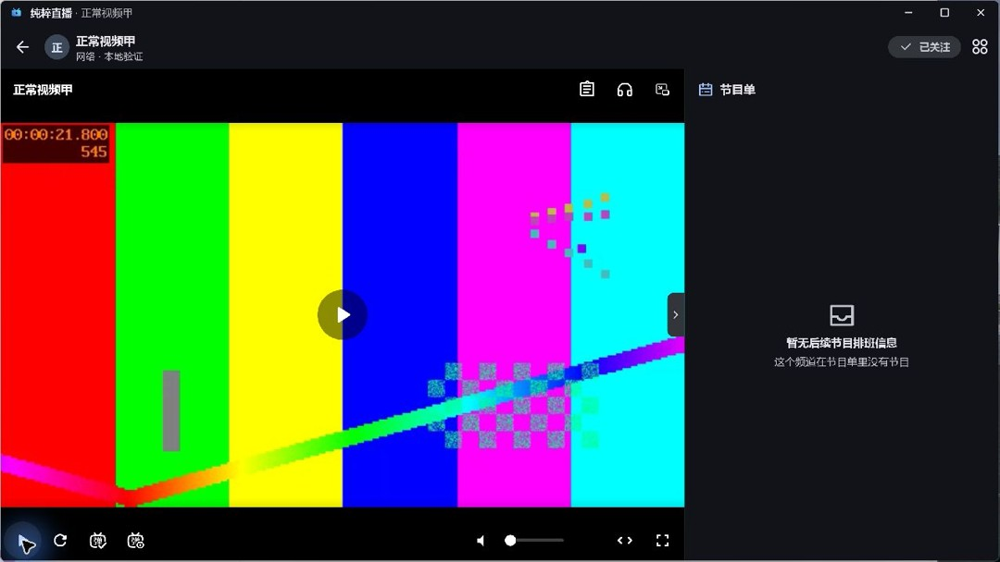
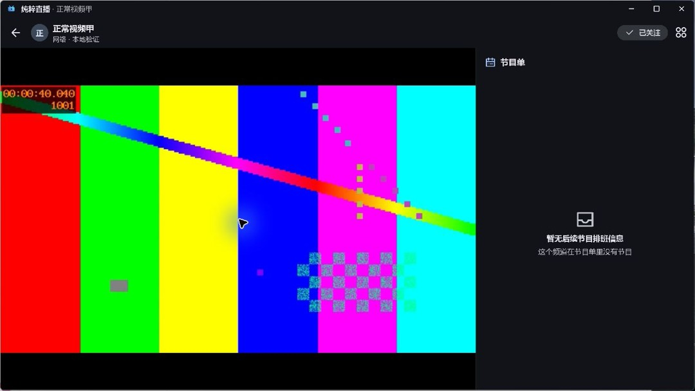
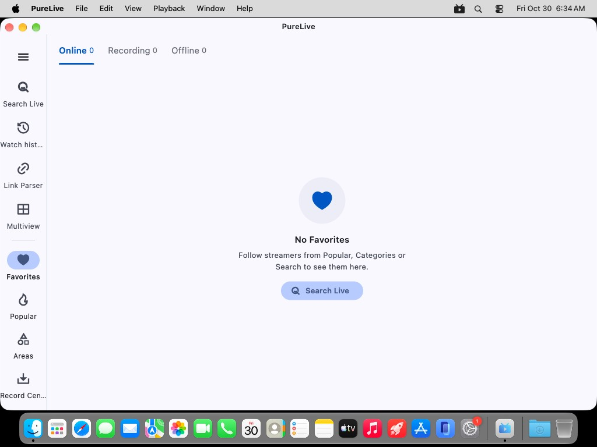
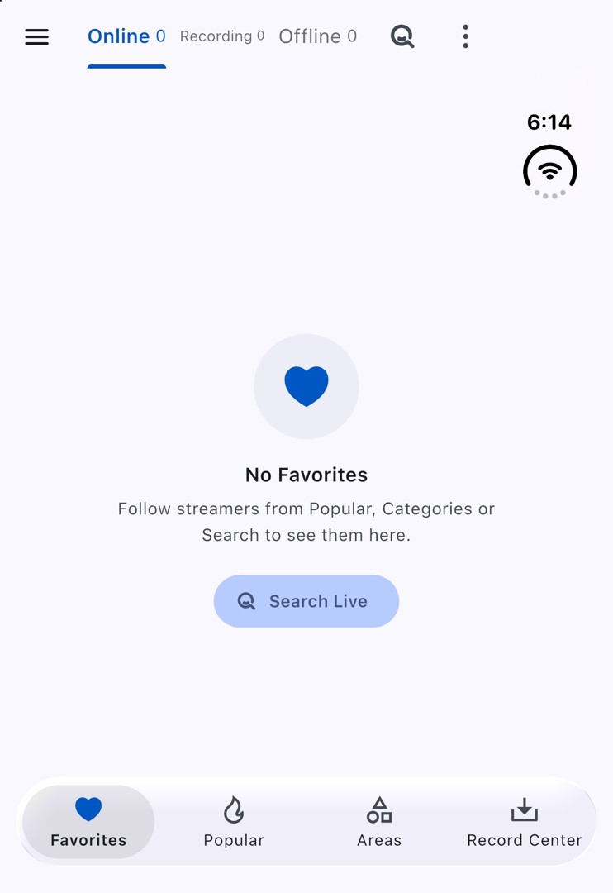

# 5.4.23验证

构建源码`42ba4d0a423a87be6626a6907fc3dc7cd2829670`，构建号5127；[PR #114](https://github.com/wzgrx/PureLive/pull/114)已合并。十个安装包及SHA256SUMS.txt逐项与本地、GitHub摘要和匿名公开下载比对，完整性清单复核通过。

最终源码的116项播放器测试与完整all/14门禁通过。Android控制器实际factory竞态、悬挂open、排队音量、初始化超时与暂停期迟到操作均有修复前失败证据。r3的原生彩条/实际黑屏对照与修正Video组件身份后的画面恢复分别保留。

最终r5原生探针在Android9/x86_64独立模拟器上检查404、连接停顿、长停顿重建与手动换线；恢复后暂停13秒，原生pause=yes、时间不推进、内核数量不变，主动resume后继续。运行时代码哈希与最终提交逐项一致。

最终普通Android profile包安装后回读APK摘要一致；普通布局启动/播放、电视布局A→连接停顿B→A均成功，返回后时间由4.52秒继续到56.08秒。已恢复自动界面模式，停止自建模拟器、环回服务和转发，保留生成数据。原Sony/v7a、Honor/Kirin硬件未操作，模拟器没有扬声器验收。

最终Windows ZIP在独立生成数据目录启动，实际打开本地彩条视频；A→连接停顿B→A恢复。点击暂停后画面停在21.8秒，超过14秒仍相同；主动继续后的截图推进至18.08、40.04秒（60秒素材按直播结束恢复机制重播）。截图中的进度、暂停视频像素和恢复后差异另行核对。应用和专用环回服务已停止，正式安装与数据未操作。

Linux最终tar.gz在私有Xvfb显示器启动，首页、导航和空关注区实际可见；此项只验启动。Apple同源构建、最终Mac ZIP两台托管机器的复开、iOS模拟器、原生录制和播放策略证据独立记录，不代表Apple原反馈硬件验收。

逐张核对五组六图及三张原生探针截图：四次最终 ZIP 启动在 5/30/90 秒及重新打开后均可见关注主页；关闭窗口后为桌面。主构建显示主页、Edit 菜单及 iOS 链接打开确认。复验菜单截图未展开菜单，不单独声称菜单交互通过。原生探针可见灰度画面、遮挡窗口和会话释放后的黑色窗口；画面推进依原生位置证据，不将这三张截图说成连续视频帧。

旧归档库新鲜基线和最终两份更新JSON下为相同六项历史版本页失败，无新增；旧客户端解析、版本比较、平台选包及全部214条历史保留通过。D-076只覆盖5.4.23的两份JSON同步，来自用户既有自主维护委托，并非新的人工单次批准；现代库完整门禁不豁免。收尾完整门禁与两库四份公开文件复读另行执行。

#49保留开放，已移除“需要补充信息”标签。取流阶段StreamUnavailable与原生打开/呈现故障分层；现有证据不支持归咎用户硬件损坏或单一运营商。原Sony/Honor复验仍是单独验收，未用模拟器成功替代。

## 最终包界面

[证据摘要与包清单](verify/evidence.json)。
