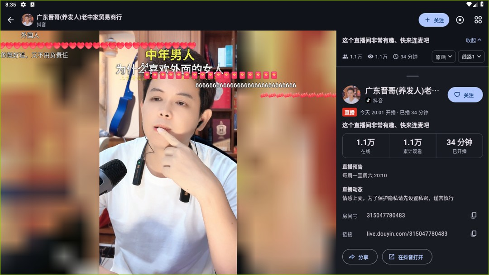
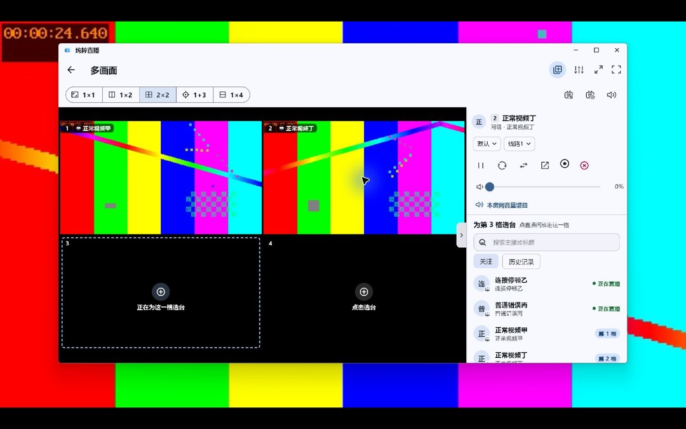
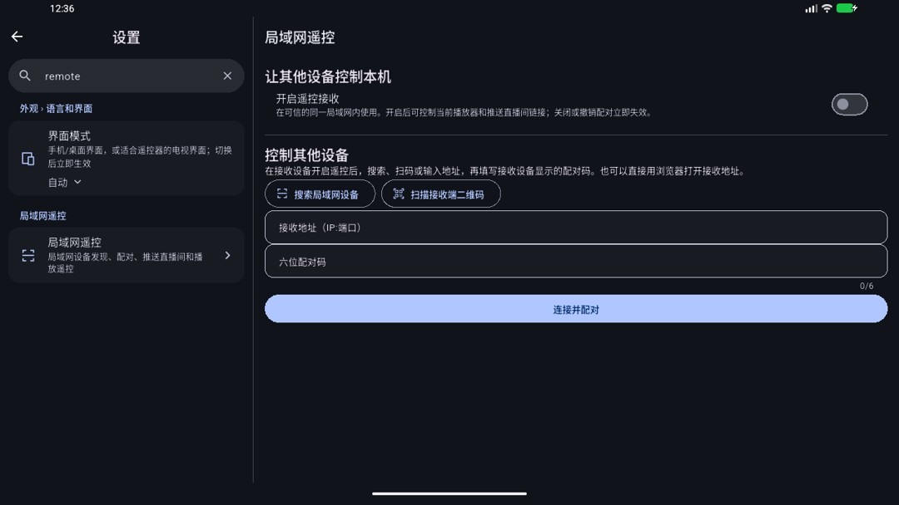
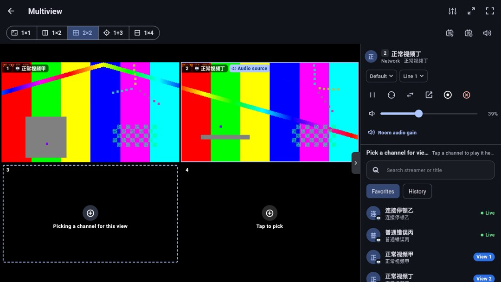
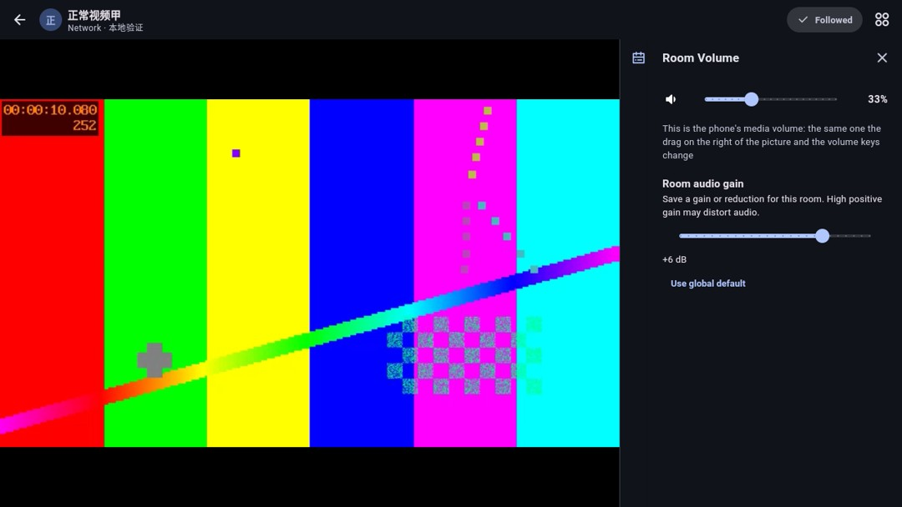
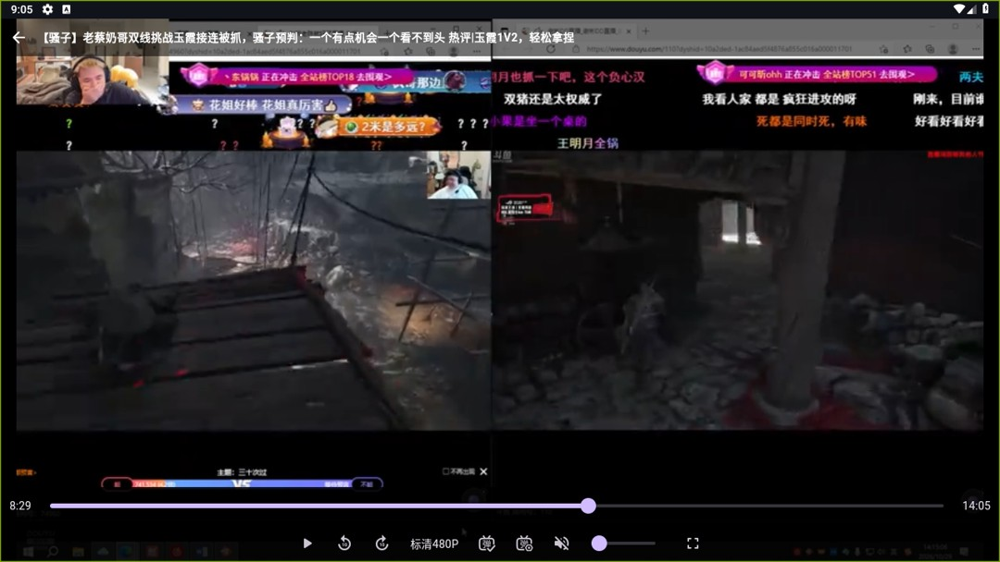
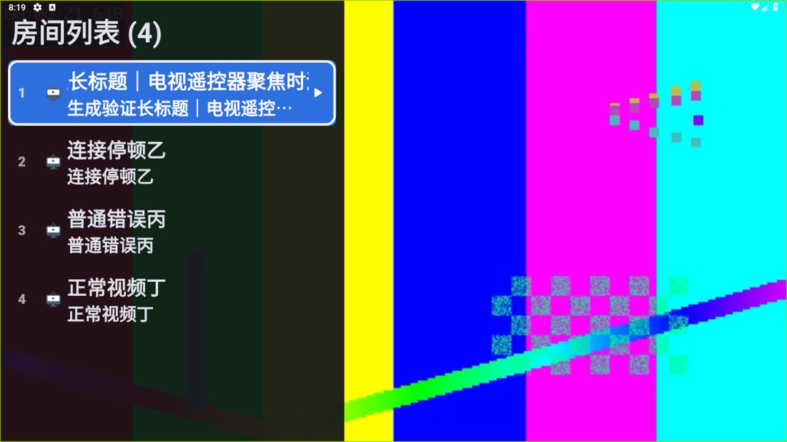
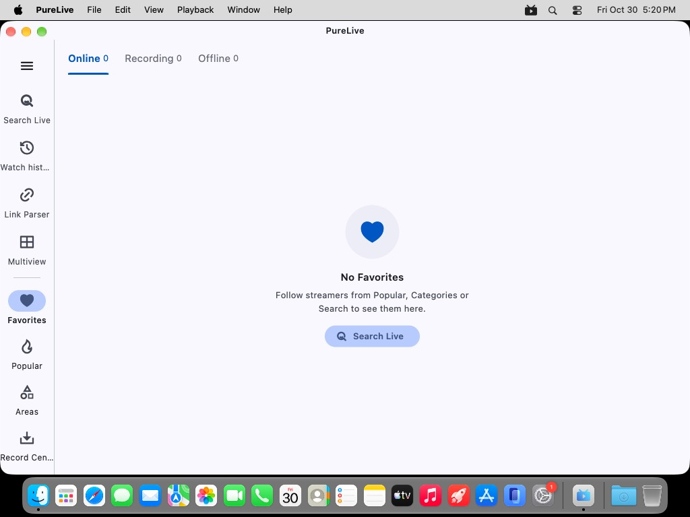

# 5.4.24验证

构建源码`f053ffc90e9d0a8ad4e69d72fe153c28d6f809cc`，构建号5128；[PR #117](https://github.com/wzgrx/PureLive/pull/117)已合并。十个安装包及SHA256SUMS.txt逐项与本地、GitHub摘要和匿名下载比对，完整性清单通过。

九项需求在同一版本实现并交付。源码完整all/14门禁、117项播放器测试及投屏真实路由/页面回归通过；最终源码包含Android17局域网运行时权限入口保护，全部15种语言均有明确拒绝提示，完整语言一致性和真实设置页面测试通过。原生工作包及历次候选保留实际源码，最终包另行复验，未混用身份。

原生实测发现并修正了三个独立生命周期问题：旧mpv实例持有静态锁堵塞替换实例；投屏替换唯一根路由导致保留旧房间；旧房间延迟释放取消新房间的全屏并在卸载锁定期间更新共享通知。修改前失败日志保留，修改后回归及Windows同窗口连续换房通过。普通桌面直播间退出全屏行为仍有回归保护。

最终同源profile/v4dev包在API37与API28安装后回读APK摘要一致。API37真实系统权限拒绝后接收保持关闭，专用提示可读，重试允许后浏览器入口200、未配对控制401。后续API37播放尝试遇到宿主模拟器退出：SwiftShader为SIGSEGV（-11），换成官方支持的lavapipe为SIGILL（-4），原失败证据保留，不声称API37播放验收通过。同一APK在此前稳定的API28专用AVD验证生成媒体A→停顿B→A恢复实际画面与时钟。Windows最终ZIP的投屏D→A→D和快速A-D-A复用同一子窗口并保持全屏；控制端保留焦点，退出多画面关闭子窗口。独立测试数据和原图保留，正式应用未操作。Linux最终TAR在私有Xvfb验证首页启动，不能据此声称Linux持续直播或原桌面全部行为已验。

其余功能的原生证据保留实际测试提交，不伪装为最终包重复执行：匿名公开抖音预告与动态，斗鱼实际回看和时间轴弹幕、暂停拖动到8:29后切换480P仍保留暂停与进度；Windows原生控制端通过专用ADB转发配对Android接收端并暂停、继续、全屏、推送公开直播间；生成音频焦点服务验证默认永久失焦暂停、共播开启继续、独立新会话瞬态中断与恢复。真实恢复计时下，停顿B经历原恢复加两次完整刷新，错误C之后正常D出帧。横屏手势、房间增益继承与清除、TV焦点长标题另有原生截图及状态证据。最终源码差异和受影响路径复验见证据摘要。

本轮没有操作K90、原Sony/Huawei/Honor/Apple硬件；AVD没有可听扬声器。实际来电、外部媒体App组合、物理局域网组播/相机扫描、显示器热插拔和第二虚拟桌面仍属未覆盖条件。功能已开发交付，相关实现任务按仓库规则保留“待真机”的补充验收状态。原问题#33/#47/#49不因上述成功而关闭，也不归咎用户硬件或单一网络。#96继续按用户指令拒绝。

#49在本轮末段提供斗鱼A=747764、B=4373285及5.4.23新日志。匿名API和CDN实测均取到HTTP200的FLV；首次64KiB样本的B画面参数因截断未知，扩大到有界1MiB后识别H.264/AAC、2560×1440/30帧，未将截断样本误判成坏流。最终普通Android v4dev在本测试网络按A→B→A实际播放，三次日志均result=playing，总耗时1846/1078/1282毫秒，B与返回A后实际画面继续变化。原Sony电视、ABI及其网络并未验证，原报告继续开放。新增手机端5.4.23反馈为斗鱼138243→8682569→593392正常，随后B站545068卡住，返回斗鱼138243也黑屏；原生日志显示同一引擎open4/5无轨道并进入恢复。它证明跨平台切换后的故障仍存在于旧版，不足以把根因归于硬件或更新镜像连接失败；本版保持开放并单独记录最终包复验。

另做最终包普通“切换直播间”原生验证：138243→8682569→B站545068，B站从线路1切到线路2后再返回138243，三次切房均为engine=reused/result=playing，耗时1383/1190/1196毫秒，已看实际画面。随后仍用普通切房入口进入生成的连接停顿房间，再返回138243，实际画面恢复，日志为engine=reused/result=playing、1412毫秒。这与远程推送每次新建引擎的实验分别记录。593392当前已下播，未声称完整重放原五房间场景，也未替代原用户硬件/网络验收。

调研对照[mpv实例及锁设计说明](https://github.com/mpv-player/mpv/blob/master/DOCS/tech-overview.txt)与[client API销毁语义](https://github.com/mpv-player/mpv/blob/master/include/mpv/client.h)：不同实例的隔离和销毁可能阻塞用于核对修复设计。具体项目缺陷仍以本地失败/通过回归为依据，不能从上游文档推断每次原机黑屏都是相同根因。

发布前新增#47现场信息已审阅：5.4.23全新安装，4K/150%缩放、GT760，偶发双层缩小画面/白屏，鼠标命中仍按外层位置，轻微拉伸立即恢复。原图在本地保留，不把它解释为网络失败或认定显卡损坏。截图异常更接近渲染表面/窗口度量未同步，但这是待验证方向，尚未确证根因。当前固定Flutter737ba8f8的空帧ResizeRenderSurface顺序已正确，不能把已修复的flutter/flutter#187922直接当作本案原因。flutter/flutter#159630仍开放；rustdesk/rustdesk#15717有有界首次呈现/子窗口重同步方案，但其FancyZones触发条件尚未在本案证实，不能据相似症状直接移植并宣称解决。本次不加入未经原场景复现的周期改尺寸补丁，保持#47开放；下一步应在同等DPI环境同时记录父/子HWND矩形、GetDpiForWindow、Flutter视图metrics与首帧/resize时间序列，以区分DPI、surface与启动次序。5.4.24九项功能及当前环境原生回归不替代这项验收。

逐张核对五组六图及三张原生探针截图：四次最终 ZIP 启动在 5/30/90 秒及重新打开后均可见关注主页；关闭窗口后为桌面。主构建显示主页、Edit 菜单及 iOS 链接打开确认。复验菜单截图未展开菜单，不单独声称菜单交互通过。原生探针可见灰度画面、遮挡窗口和会话释放后的黑色窗口；画面推进依原生位置证据，不将这三张截图说成连续视频帧。

| 需求 | 已观察到的原生行为 | 实际测试源码 |
|---|---|---|
| [#101](https://github.com/wzgrx/PureLive/issues/101) | 匿名公开动态和真实循环预告显示 | `4d53681d9cdb` |
| [#102](https://github.com/wzgrx/PureLive/issues/102) | 同一投屏窗口反复换房、快速连点、全屏保持和退出清理 | `f053ffc90e9d` |
| [#105](https://github.com/wzgrx/PureLive/issues/105) | 原生Windows到Android配对、暂停/继续、全屏、推送公开房间 | `4d53681d9cdb` |
| [#106](https://github.com/wzgrx/PureLive/issues/106) | 选中格子独立音量手势、亮度覆盖及退出恢复 | `bce367e4f5f4` |
| [#108](https://github.com/wzgrx/PureLive/issues/108) | 正负分贝持久化、多画面继承、清除覆盖 | `bce367e4f5f4` |
| [#109](https://github.com/wzgrx/PureLive/issues/109) | 公开视频与弹幕、暂停拖动8:29、480P切换保留暂停和进度 | `4d53681d9cdb` |
| [#110](https://github.com/wzgrx/PureLive/issues/110) | 默认永久失焦暂停、可选共播、独立会话瞬态暂停与恢复 | `4d53681d9cdb` |
| [#112](https://github.com/wzgrx/PureLive/issues/112) | 电视长标题焦点滚动、离焦停止、控制栏加粗 | `bce367e4f5f4` |
| [#115](https://github.com/wzgrx/PureLive/issues/115) | 实际生产计时：原恢复加两次完整刷新，失败后再跳转 | `4d53681d9cdb` |

旧归档库新鲜基线与最终两份JSON下是相同六项历史版本页失败，无新增；旧客户端解析、版本比较、平台选包及全部215条历史保留通过。D-078只覆盖本版两个JSON，依据用户既有自主维护委托，未声称新的人工单次批准；现代源码及收尾完整门禁不豁免。

## 界面证据

[原始截图摘要、构建身份与十包清单](verify/evidence.json)。
